

  

# SIMPRES – Sistem Presensi Simbang

Aplikasi presensi pegawai UPTD Puskesmas Simbang. Terdiri dari tiga bagian:

| Bagian | Teknologi | Folder |
|---|---|---|
| Aplikasi Android (pegawai) | Kotlin + XML, Navigation Component, Retrofit, Lottie | `app/` |
| REST API (server) | Laravel, Laravel Sanctum, MySQL/MariaDB | `backend/` |
| Admin Web (admin Puskesmas) | Laravel Blade, satu file CSS, tanpa npm | `backend/` (alamat `/admin`) |

Aturan utama: absensi sah otomatis jika pegawai berada maksimal 150 m dari titik Puskesmas.
Keputusan sah atau tidaknya absensi dibuat di server, bukan di HP.

## Versi aplikasi

| Versi | Minggu | Tanggal | Status | Isi utama |
|---|---|---|---|---|
| [v0.1.0](#v010--prototipe-tampilan-android) | Minggu 12 | 11 November 2026 | Selesai | Prototipe tampilan Android (29 halaman) |
| [v0.2.0](#v020--backend-admin-web-dan-integrasi-aplikasi) | Minggu 13 | 18 November 2026 | Selesai | Basis data, REST API, CRUD, validasi absensi, Admin Web, aplikasi tersambung ke server |
| [v0.3.0](#v030--integrasi-penuh-dan-pengujian-rencana) | Minggu 14 | 25 November 2026 | Rencana | Integrasi end-to-end, pengujian sistem, evaluasi mitra, demo prototipe |
| [v1.0.0](#v100--rilis-rencana) | Minggu 15 | 2 Desember 2026 | Rencana | Rilis di hosting, APK rilis, video, laporan PjBL |

Riwayat perubahan lengkap per versi ada di [docs/CHANGELOG.md](docs/CHANGELOG.md).

---

## v0.1.0 – Prototipe tampilan Android

Minggu 12 (11 November 2026). Checkpoint: implementasi halaman Android, Splash Screen, onboarding, login, navigasi, dashboard.

| Profil | Splash | Login | Riwayat |
|---|---|---|---|
| 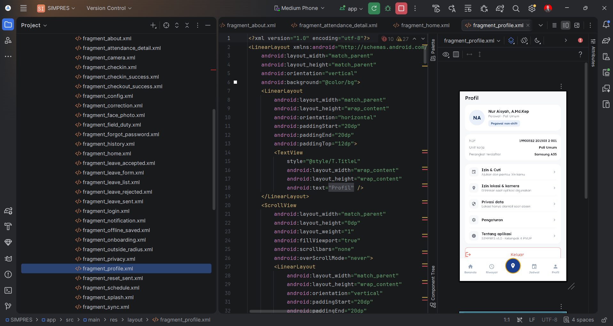 |  | 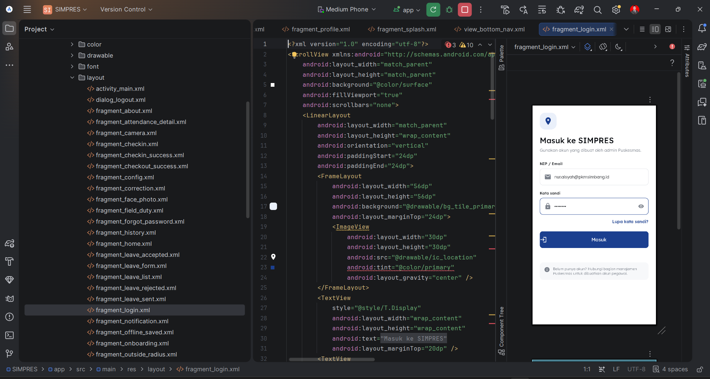 |  |

| Tentang aplikasi | Dialog keluar | Onboarding | Notifikasi |
|---|---|---|---|
| 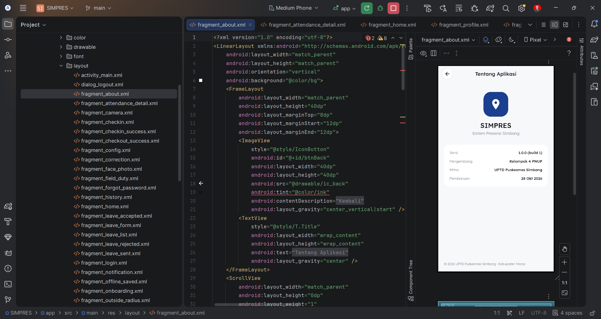 | 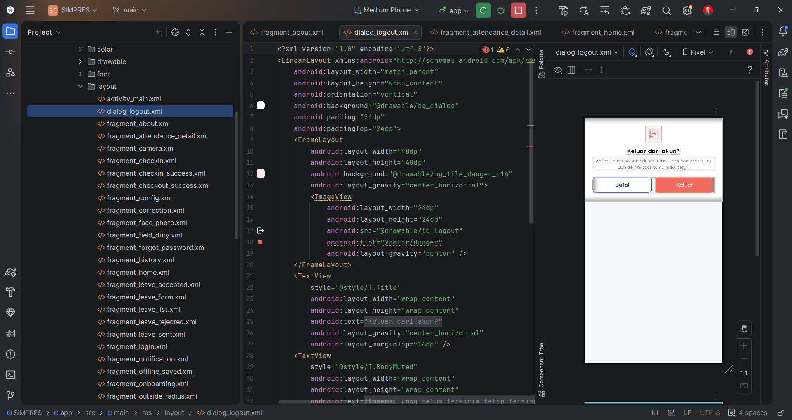 |  |  |

Pratinjau layout dari Android Studio (tema terang):

| Splash | Login | Beranda | Riwayat | Profil |
|---|---|---|---|---|
|  |  |  | 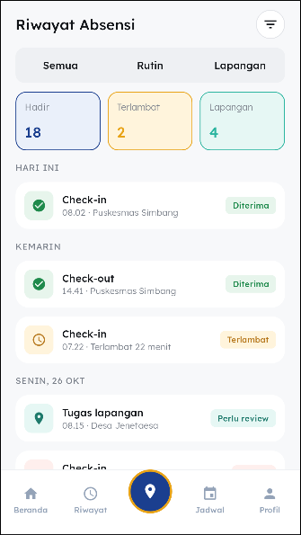 |  |

Isi versi ini: 29 layout halaman, tema terang dan gelap, font Lexend, Navigation Graph, BaseFragment dan bottom navigation,
alur check-in dengan radius 150 m (data contoh), jarak ikon dan animasi ikon ringan.

---

## v0.2.0 – Backend, Admin Web, dan integrasi aplikasi

Minggu 13 (18 November 2026). Checkpoint: implementasi fitur utama, basis data, CRUD, REST API, dan aturan validasi absensi.

### Aplikasi Android

| Onboarding | Panduan awal | Beranda | Check-in berhasil |
|---|---|---|---|
| 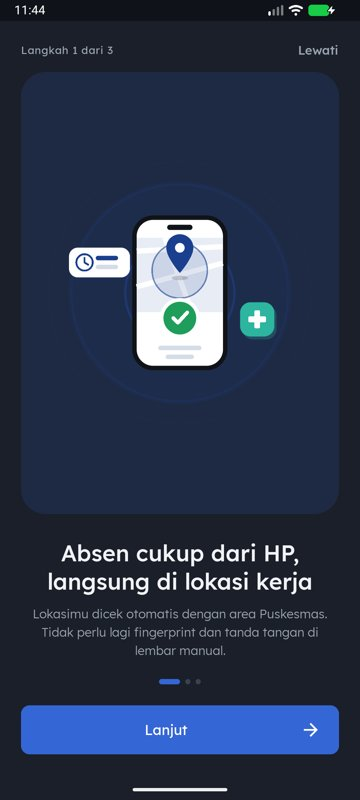 | 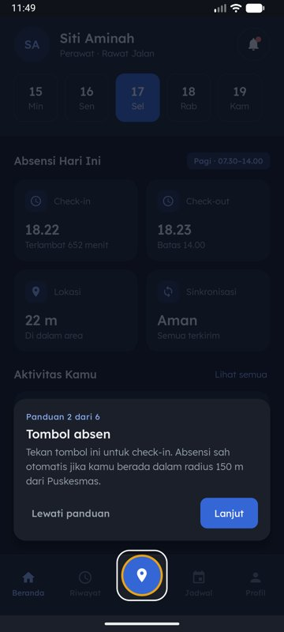 | 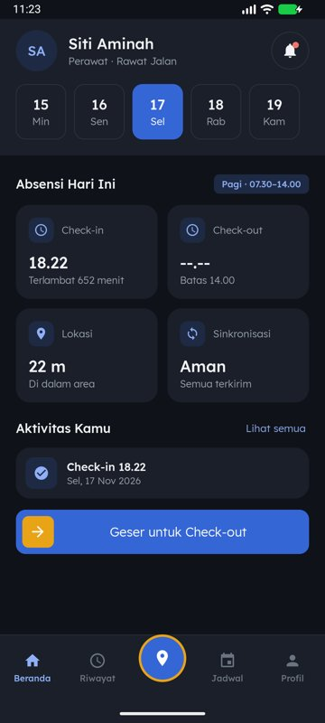 |  |

| Izin & Cuti | Riwayat | Notifikasi | Profil |
|---|---|---|---|
| 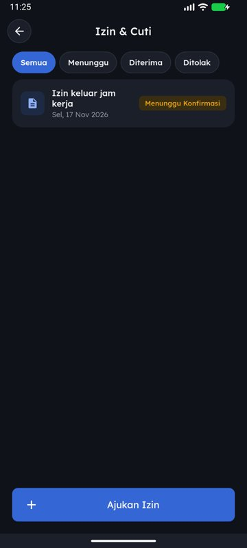 | 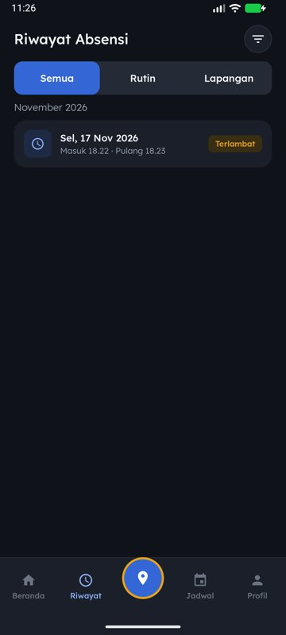 | 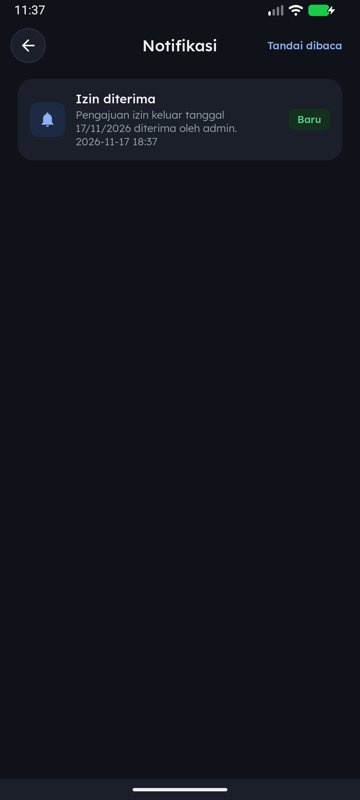 | 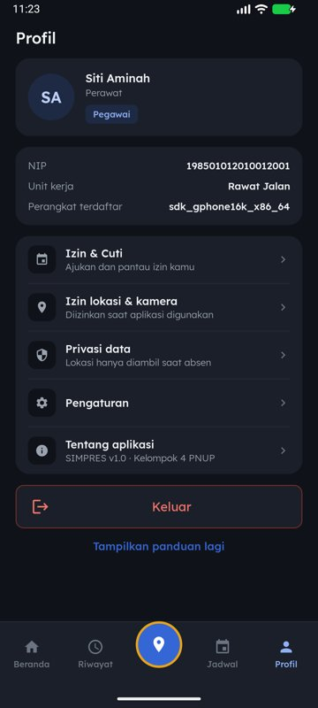 |

### Logo, mode terang, dan mode gelap

Logo aplikasi: pin lokasi dengan tanda centang dan cincin radius emas, dipakai sebagai ikon aplikasi, di halaman Login, dan Tentang Aplikasi.
Tampilan bisa dipilih di **Profil > Pengaturan & tampilan > Mode terang / gelap** (Ikuti sistem, Terang, atau Gelap).

| Beranda – terang | Beranda – gelap | Pilihan tampilan | Logo di Login | Tentang aplikasi |
|---|---|---|---|---|
| 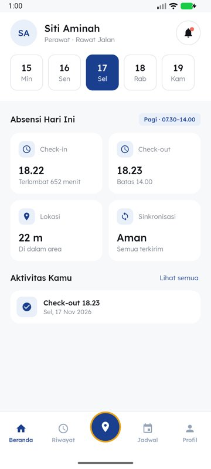 |  | 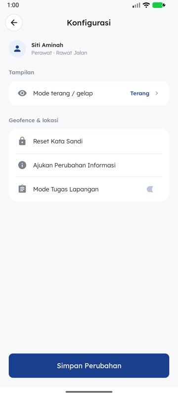 | 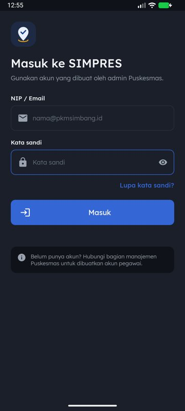 |  |

### Admin Web

| Dashboard | Review & Persetujuan | Roster |
|---|---|---|
|  |  |  |

| Rekap & Ekspor | Audit Log | Konfigurasi |
|---|---|---|
|  | 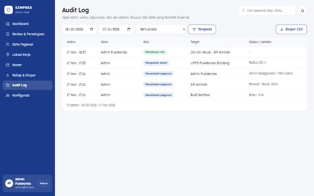 | 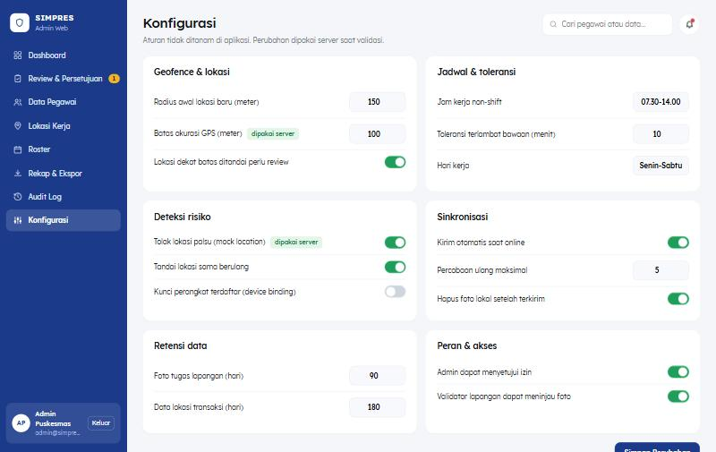 |

### ERD database

10 tabel MySQL. Garis memakai notasi crow's foot: `||` tepat satu, `o|` nol atau satu, `o<` nol atau banyak.

### Flowchart

| Absensi (check-in dan check-out) | Pengajuan izin, koreksi, dan tugas lapangan |
|---|---|
| 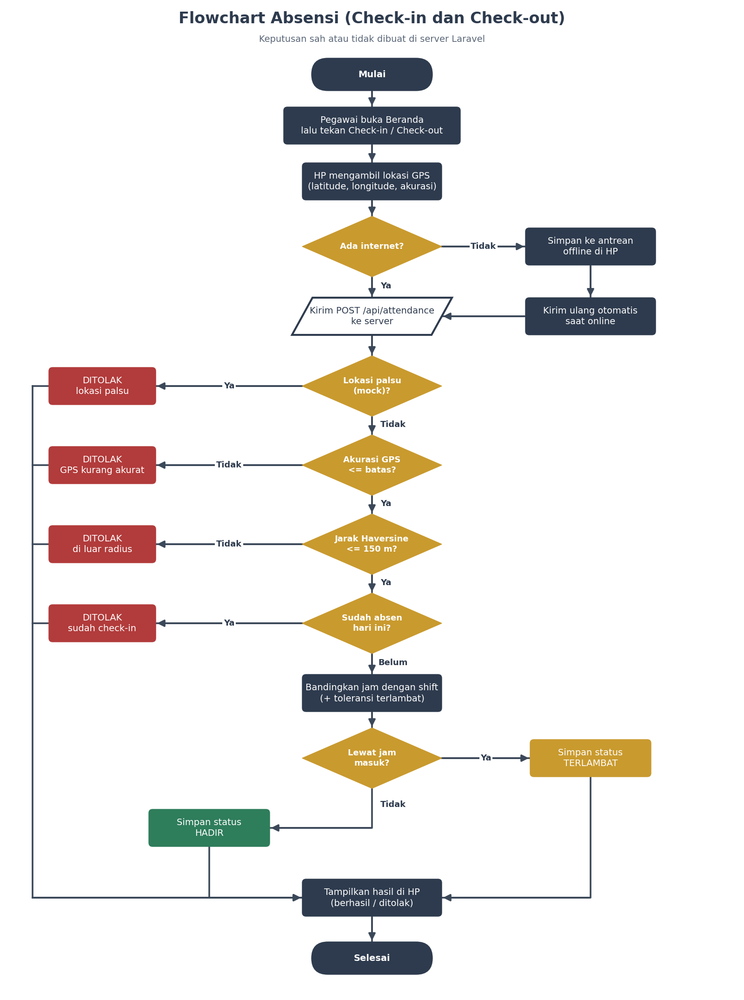 |  |

### Cuplikan kode

Validasi absensi di server (`backend/app/Services/AttendanceValidator.php`): jarak dihitung dengan rumus Haversine,
lalu dicek lokasi palsu, akurasi GPS, dan radius lokasi kerja.

Check-in di aplikasi (`ui/attendance/AttendanceScreens.kt`): ambil GPS, kirim ke server, lalu pindah halaman sesuai hasil.
Kalau tidak ada internet, absensi disimpan ke antrean offline.

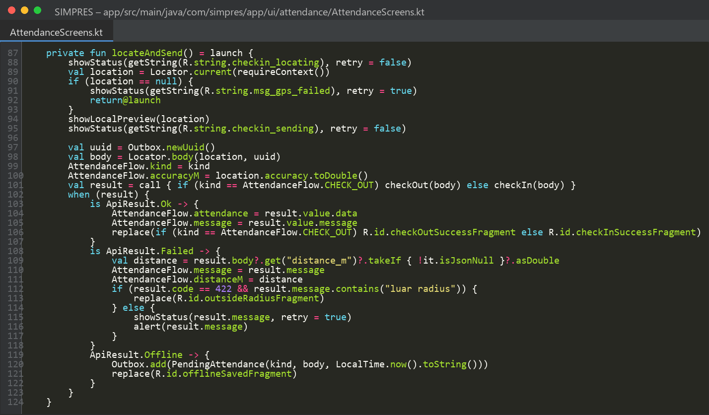

Daftar endpoint REST API (`backend/routes/api.php`), semua kecuali login memakai token Sanctum.

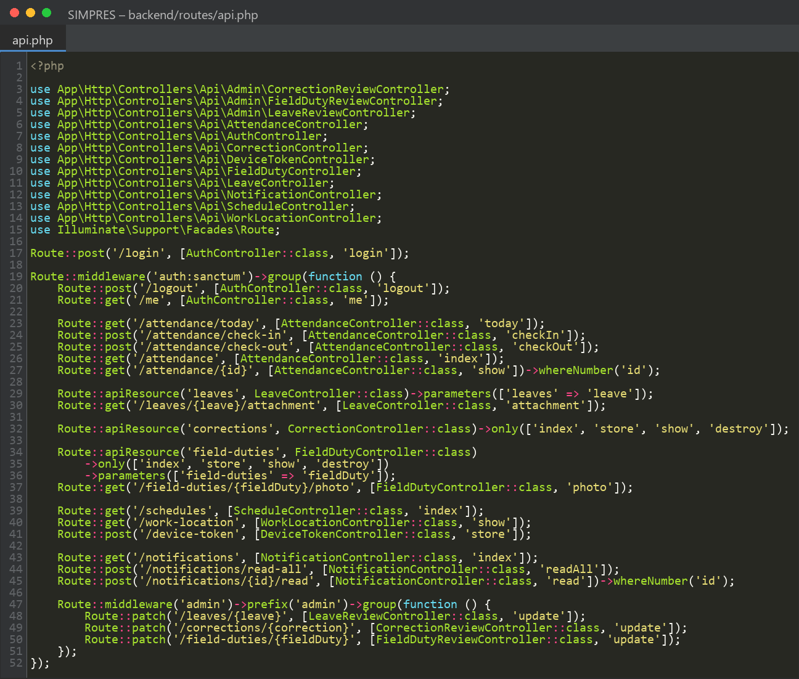

### Fitur yang selesai

| Agenda | Hasil |
|---|---|
| Basis data | 10 tabel MySQL (ERD di atas, skrip `docs/database/simpres.sql`) |
| REST API | 32 endpoint, login token Sanctum, dokumentasi di `backend/API.md` |
| Aturan validasi absensi | Jarak Haversine maks. 150 m, akurasi GPS, tolak lokasi palsu, satu check-in per hari, status terlambat, izin diterima |
| CRUD | Izin dan cuti, koreksi absensi, tugas lapangan dengan foto, pegawai, shift, jadwal |
| Admin Web | Dashboard, Review & Persetujuan, Data Pegawai, Lokasi Kerja, Roster, Rekap & Ekspor CSV, Audit Log, Konfigurasi |
| Aplikasi Android | Login, check-in GPS, check-out geser, riwayat, jadwal, izin, koreksi, tugas lapangan, notifikasi, profil, antrean offline |
| Tampilan | Logo dan ikon aplikasi, pilihan mode terang/gelap, intro animasi Lottie, onboarding 3 halaman, panduan awal (coach mark) saat pertama masuk Beranda |
| Pengujian | 133 test otomatis backend lulus; alur aplikasi dan web diuji di emulator dan browser |

---

## v0.3.0 – Integrasi penuh dan pengujian (rencana)

Minggu 14 (25 November 2026). Checkpoint: penyelesaian fitur, integrasi end-to-end, pengujian sistem, evaluasi mitra, demo prototipe.

- Notifikasi push lewat Firebase Cloud Messaging (token perangkat sudah disimpan di server).
- Kirim ulang antrean offline otomatis di latar belakang (WorkManager).
- Kamera bukti tugas lapangan dengan CameraX dan peta asli di halaman check-in.
- Penyimpanan token login terenkripsi (Android Keystore).
- Pengujian sistem bersama pegawai Puskesmas, perbaikan dari hasil evaluasi mitra, demo prototipe.

## v1.0.0 – Rilis (rencana)

Minggu 15 (2 Desember 2026). Checkpoint: fitur utama final, CRUD, basis data, REST API, pengujian sistem, video, laporan PjBL.

- Backend dan Admin Web dipasang di hosting dengan HTTPS (panduan di `backend/DEPLOY.md`).
- APK rilis untuk pegawai, akun contoh diganti akun asli.
- Video demonstrasi dan laporan akhir PjBL.

---

## Menjalankan proyek

### Backend dan Admin Web
1. Jalankan MySQL (Laragon), lalu buat database dari `docs/database/simpres.sql`.
2. Di folder `backend`: `composer install`, salin `.env.example` menjadi `.env`, isi koneksi database, lalu `php artisan key:generate` dan `php artisan migrate`.
3. Jalankan `php artisan serve`. Admin Web ada di `http://127.0.0.1:8000/admin`.
4. Test otomatis: `php artisan test` (database `simpres_test`, dibuat dengan `tests/buat-database-test.ps1`).

### Aplikasi Android
1. Android Studio → **Open** → folder `SIMPRES`, tunggu Gradle sync.
2. Emulator memakai server laptop lewat `http://10.0.2.2:8000/api/`. Untuk HP asli atau hosting, isi
   `simpres.apiUrl=https://alamat-server/api/` di `local.properties`.
3. Jalankan konfigurasi `app` (Android 8.0 ke atas).

Akun contoh dari data awal (ganti sebelum online): `admin@simpres.test`, `siti@simpres.test`, `budi@simpres.test`, sandi `simpres123`.

## Struktur kode Android

| Folder | Isi |
|---|---|
| `data/` | `Api.kt` (Retrofit dan model), `Session.kt` (token dan antrean offline), `Locator.kt` (GPS), `Format.kt` (format tanggal dan status) |
| `ui/BaseFragment.kt` | Navigasi bersama, bottom navigation, cek koneksi, coroutine per halaman |
| `ui/<fitur>/*Screens.kt` | Satu Fragment per halaman: auth, home, attendance, leave, settings |
| `ui/CoachMarks.kt` | Panduan awal yang menyorot tombol penting, tampil sekali |
| `res/raw/` | Animasi Lottie intro dan onboarding |
| `res/layout` | 29 layout halaman + komponen baris daftar |

## Daftar halaman dan layout Android

| Halaman | Layout | | Halaman | Layout |
|---|---|---|---|---|
| 01 Splash | `fragment_splash` | | 16 Profil | `fragment_profile` (+ `dialog_logout`) |
| 02 Onboarding | `fragment_onboarding` | | 17 Konfigurasi | `fragment_config` |
| 03 Login | `fragment_login` | | 18 Lupa Kata Sandi | `fragment_forgot_password` |
| 04 Beranda | `fragment_home` | | 19 Tautan Terkirim | `fragment_reset_sent` |
| 05 Check-in | `fragment_checkin` | | 20 Check-out Berhasil | `fragment_checkout_success` |
| 06 Di Luar Radius | `fragment_outside_radius` | | 21 Izin & Cuti | `fragment_leave_list` |
| 07 Foto Wajah (opsional) | `fragment_face_photo` | | 22 + 23 Ajukan Izin | `fragment_leave_form` |
| 08 Check-in Berhasil | `fragment_checkin_success` | | 24 Izin Terkirim | `fragment_leave_sent` |
| 09 Tersimpan Offline | `fragment_offline_saved` | | 25 Detail Izin – Diterima | `fragment_leave_accepted` |
| 10 Tugas Lapangan | `fragment_field_duty` | | 26 Detail Izin – Ditolak | `fragment_leave_rejected` |
| 11 Kamera Bukti | `fragment_camera` | | 27 Notifikasi | `fragment_notification` |
| 12 Riwayat | `fragment_history` | | 28 Antrean Sinkronisasi | `fragment_sync` |
| 13 Detail Absensi | `fragment_attendance_detail` | | 29 Izin & Privasi | `fragment_privacy` |
| 14 Jadwal Kerja | `fragment_schedule` | | 30 Tentang Aplikasi | `fragment_about` |
| 15 Ajukan Koreksi | `fragment_correction` | | | |

---

PjBL Aplikasi Mobile · Kelompok 4 · Mitra UPTD Puskesmas Simbang
