

  

# SIMPRES – Sistem Presensi Simbang

Aplikasi presensi pegawai UPTD Puskesmas Simbang. Terdiri dari tiga bagian:

| Bagian | Teknologi | Folder |
|---|---|---|
| Aplikasi Android (pegawai) | Kotlin + XML, Navigation Component, Retrofit, Lottie | `app/` |
| REST API (server) | Laravel, Laravel Sanctum, MySQL/MariaDB | `backend/` |
| Admin Web (admin Puskesmas) | Laravel Blade, satu file CSS, tanpa npm | `backend/` (alamat `/admin`) |

Aturan utama: absensi sah otomatis jika pegawai berada maksimal 150 m dari titik Puskesmas.
Keputusan sah atau tidaknya absensi dibuat di server, bukan di HP.

## Versi aplikasi

| Versi | Minggu | Tanggal | Status | Isi utama |
|---|---|---|---|---|
| [v0.1.0](#v010--prototipe-tampilan-android) | Minggu 12 | 11 November 2026 | Selesai | Prototipe tampilan Android (29 halaman) |
| [v0.2.0](#v020--backend-admin-web-dan-integrasi-aplikasi) | Minggu 13 | 18 November 2026 | Selesai | Basis data, REST API, CRUD, validasi absensi, Admin Web, aplikasi tersambung ke server |
| [v0.3.0](#v030--pengujian-fitur-dan-perbaikan-bug) | Minggu 14 | 25 November 2026 | **Sedang berjalan** | Pengujian fitur dan perbaikan bug |
| [v1.0.0](#v100--rilis-rencana) | Minggu 15 | 2 Desember 2026 | Rencana | Rilis di hosting, APK rilis, video, laporan PjBL |

Riwayat perubahan lengkap per versi ada di [docs/CHANGELOG.md](docs/CHANGELOG.md).

---

## v0.1.0 – Prototipe tampilan Android

Minggu 12 (11 November 2026). Checkpoint: implementasi halaman Android, Splash Screen, onboarding, login, navigasi, dashboard.

| Profil | Splash | Login | Riwayat |
|---|---|---|---|
|  | 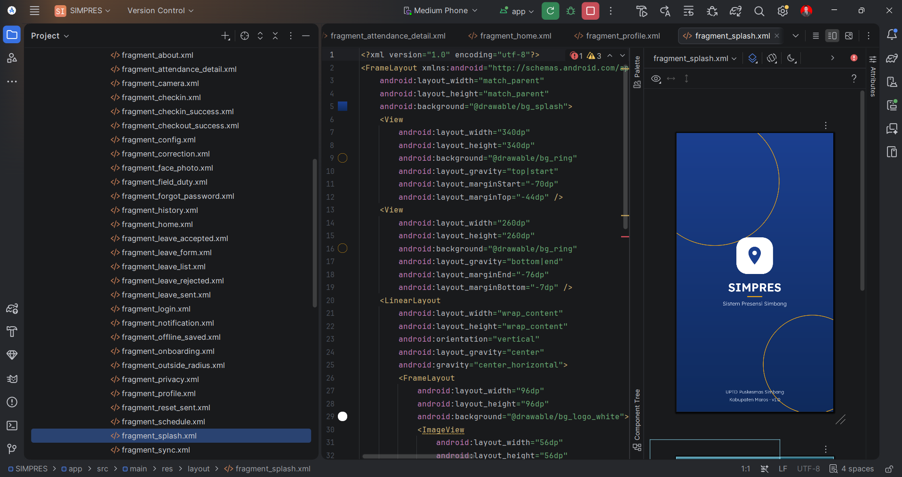 |  | 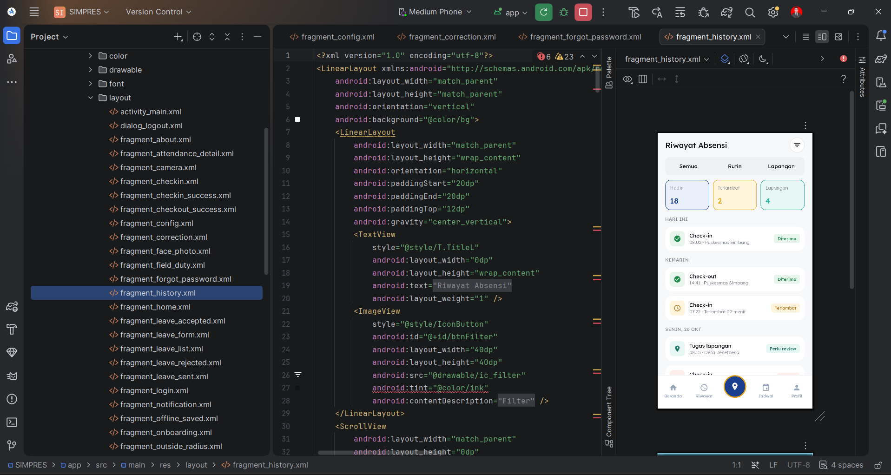 |

| Tentang aplikasi | Dialog keluar | Onboarding | Notifikasi |
|---|---|---|---|
|  |  | 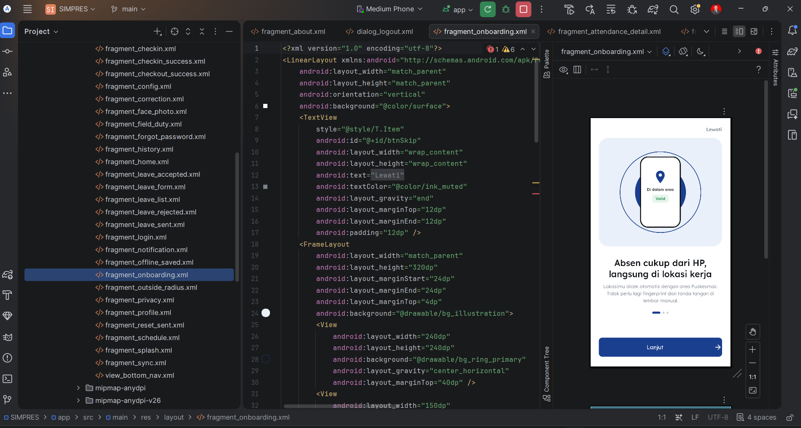 | 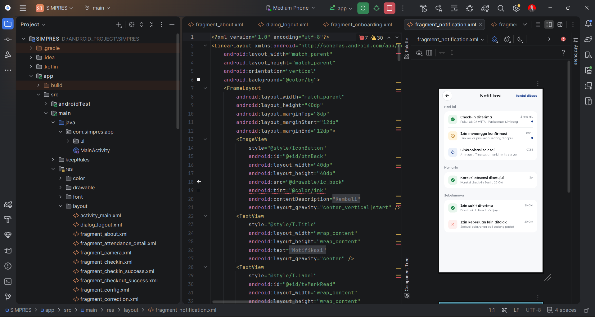 |

Pratinjau layout dari Android Studio (tema terang):

| Splash | Login | Beranda | Riwayat | Profil |
|---|---|---|---|---|
| 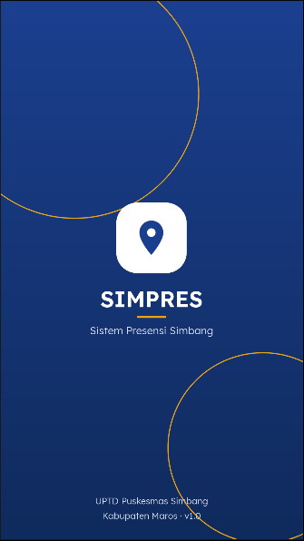 | 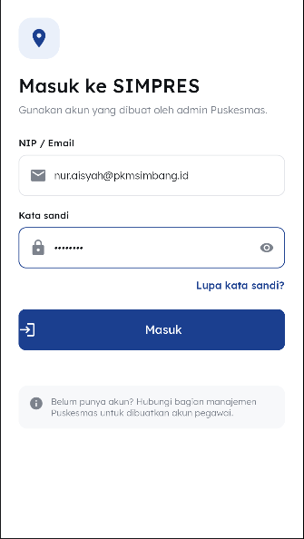 | 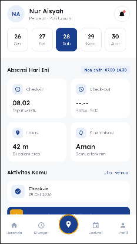 |  | 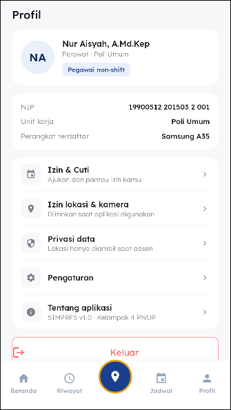 |

Isi versi ini: 29 layout halaman, tema terang dan gelap, font Lexend, Navigation Graph, BaseFragment dan bottom navigation,
alur check-in dengan radius 150 m (data contoh), jarak ikon dan animasi ikon ringan.

---

## v0.2.0 – Backend, Admin Web, dan integrasi aplikasi

Minggu 13 (18 November 2026). Checkpoint: implementasi fitur utama, basis data, CRUD, REST API, dan aturan validasi absensi.

### Aplikasi Android

| Onboarding | Panduan awal | Beranda | Check-in berhasil |
|---|---|---|---|
|  |  |  | 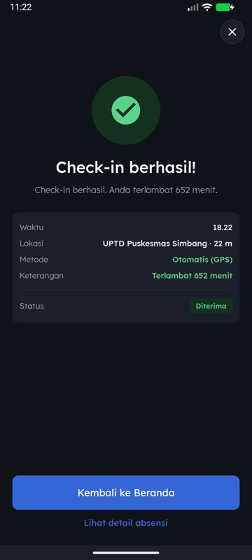 |

| Izin & Cuti | Riwayat | Notifikasi | Profil |
|---|---|---|---|
|  |  |  |  |

### Logo, mode terang, dan mode gelap

Logo aplikasi: pin lokasi dengan tanda centang dan cincin radius emas, dipakai sebagai ikon aplikasi, di halaman Login, dan Tentang Aplikasi.
Tampilan bisa dipilih di **Profil > Pengaturan & tampilan > Mode terang / gelap** (Ikuti sistem, Terang, atau Gelap).

| Beranda – terang | Beranda – gelap | Pilihan tampilan | Logo di Login | Tentang aplikasi |
|---|---|---|---|---|
|  | 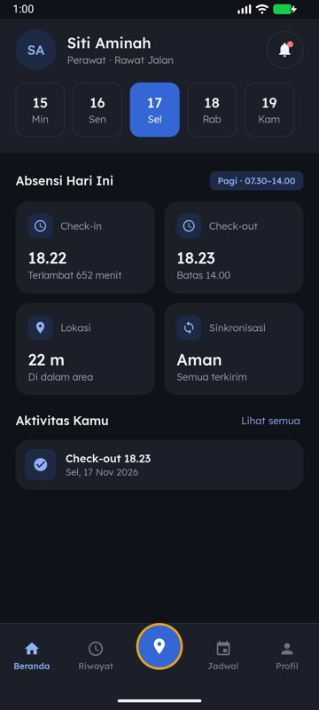 |  |  | 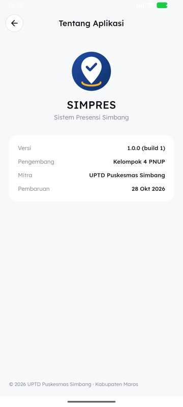 |

### Admin Web

| Dashboard | Review & Persetujuan | Roster |
|---|---|---|
| 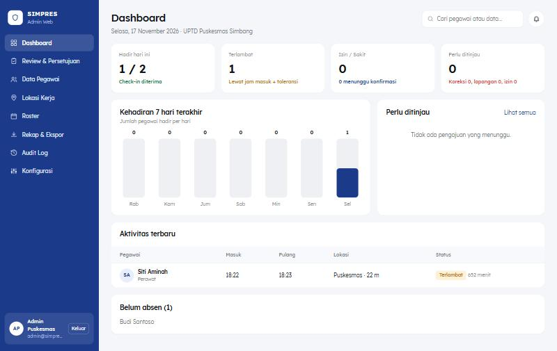 | 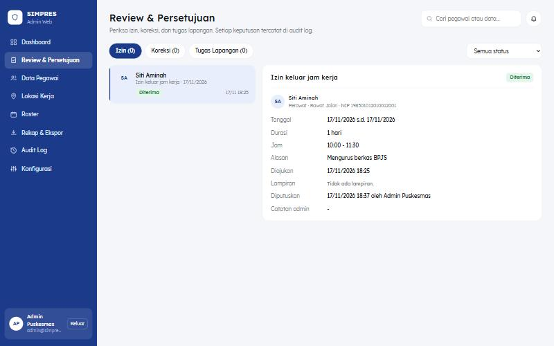 | 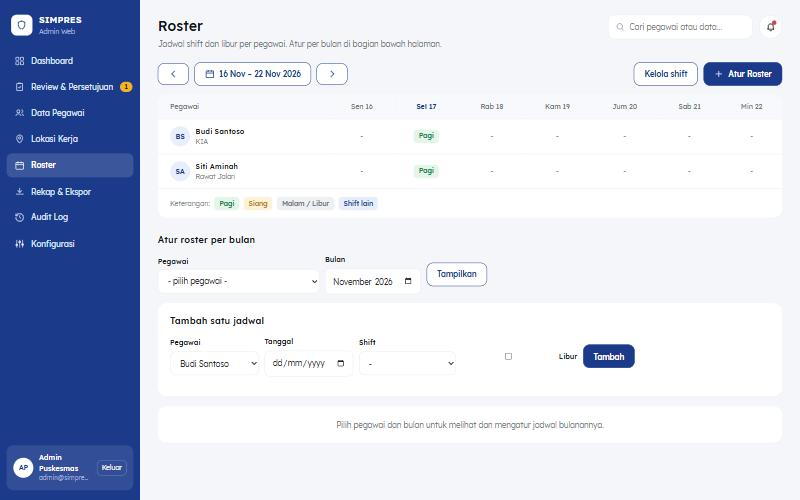 |

| Rekap & Ekspor | Audit Log | Konfigurasi |
|---|---|---|
| 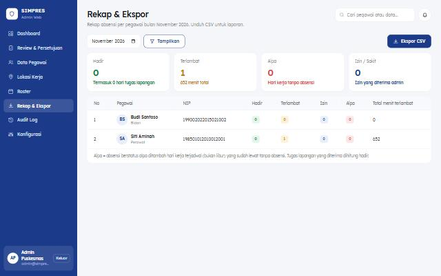 |  |  |

### ERD database

10 tabel MySQL. Garis memakai notasi crow's foot: `||` tepat satu, `o|` nol atau satu, `o<` nol atau banyak.

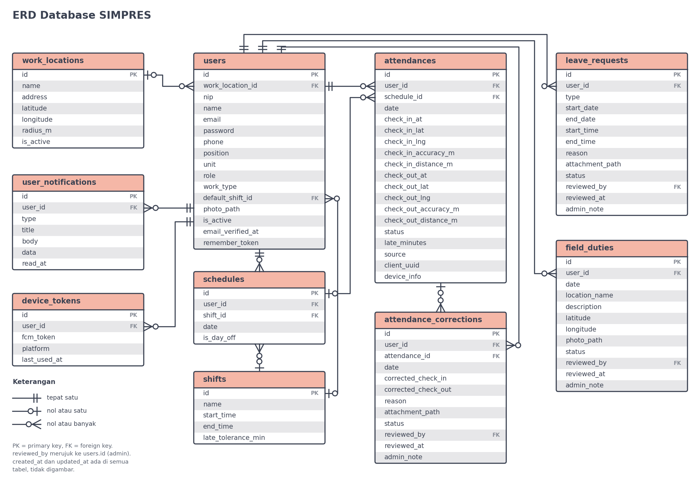

### Flowchart

| Absensi (check-in dan check-out) | Pengajuan izin, koreksi, dan tugas lapangan |
|---|---|
|  | 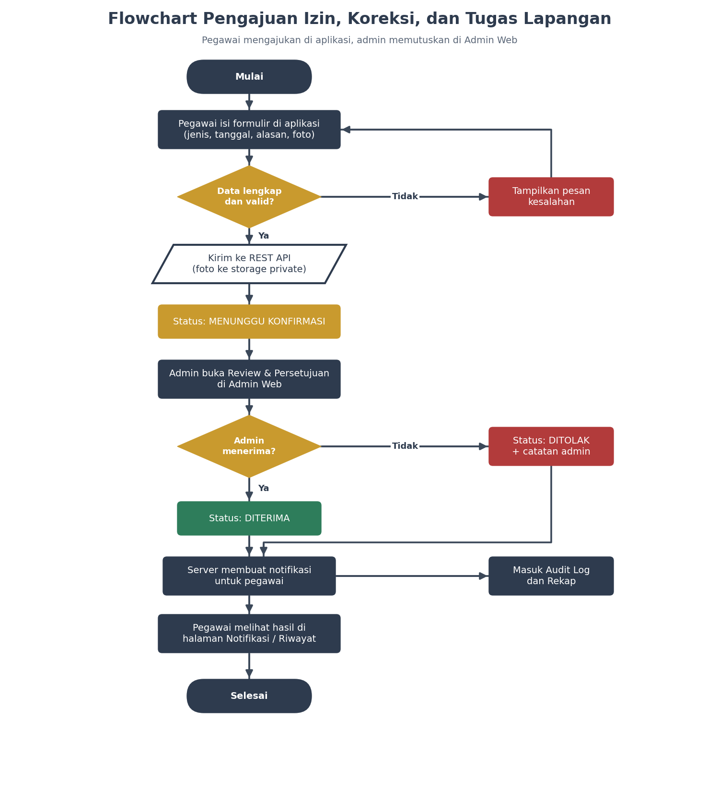 |

### Cuplikan kode

Validasi absensi di server (`backend/app/Services/AttendanceValidator.php`): jarak dihitung dengan rumus Haversine,
lalu dicek lokasi palsu, akurasi GPS, dan radius lokasi kerja.

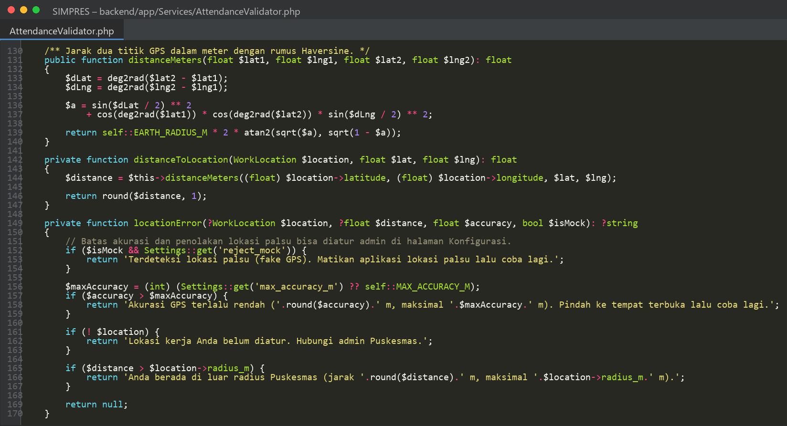

Check-in di aplikasi (`ui/attendance/AttendanceScreens.kt`): ambil GPS, kirim ke server, lalu pindah halaman sesuai hasil.
Kalau tidak ada internet, absensi disimpan ke antrean offline.

Daftar endpoint REST API (`backend/routes/api.php`), semua kecuali login memakai token Sanctum.

### Fitur yang selesai

| Agenda | Hasil |
|---|---|
| Basis data | 10 tabel MySQL (ERD di atas, skrip `docs/database/simpres.sql`) |
| REST API | 32 endpoint, login token Sanctum, dokumentasi di `backend/API.md` |
| Aturan validasi absensi | Jarak Haversine maks. 150 m, akurasi GPS, tolak lokasi palsu, satu check-in per hari, status terlambat, izin diterima |
| CRUD | Izin dan cuti, koreksi absensi, tugas lapangan dengan foto, pegawai, shift, jadwal |
| Admin Web | Dashboard, Review & Persetujuan, Data Pegawai, Lokasi Kerja, Roster, Rekap & Ekspor CSV, Audit Log, Konfigurasi |
| Aplikasi Android | Login, check-in GPS, check-out geser, riwayat, jadwal, izin, koreksi, tugas lapangan, notifikasi, profil, antrean offline |
| Tampilan | Logo dan ikon aplikasi, pilihan mode terang/gelap, intro animasi Lottie, onboarding 3 halaman, panduan awal (coach mark) saat pertama masuk Beranda |

---

## v0.3.0 – Pengujian fitur dan perbaikan bug

Minggu 14 (25 November 2026). Minggu ini berisi **pengujian semua fitur** aplikasi Android dan Admin Web untuk setiap
peran, lalu **memperbaiki bug** yang ditemukan.

### Skema pengujian

Semua fitur per peran (admin, pegawai non-shift, pegawai shift, petugas lapangan), cara pakai, dan langkah pengujiannya
ada di [docs/SKEMA_PENGUJIAN.md](docs/SKEMA_PENGUJIAN.md): 129 langkah uji untuk Admin Web, aplikasi, mode offline, notifikasi,
alur aplikasi ke website, keamanan, dan test otomatis. Hasil pengujian per pengguna ada di
[docs/HASIL_PENGUJIAN.md](docs/HASIL_PENGUJIAN.md).

### Unduh aplikasi

Scan QR atau buka [halaman rilis](https://github.com/VibeCoderFinalBoss99/SIMPRES/releases/latest) untuk mengunduh `SIMPRES.apk`.

### Ditambah minggu ini

| Fitur | Keterangan |
|---|---|
| Lupa kata sandi | Tautan atur ulang dikirim ke email akun yang dicari lewat NIP atau email, halaman web untuk membuat sandi baru |
| Peta asli di check-in | Peta OpenStreetMap dengan radius 150 m, titik Puskesmas, dan posisi pegawai. Bisa digeser dan di-zoom |
| Cuti di aplikasi | Pilihan Cuti di formulir izin, dengan rentang tanggal dan lampiran opsional |
| Menu Koreksi Absensi | Halaman koreksi absensi bisa dibuka dari Profil |
| Notifikasi HP | Keputusan admin muncul di HP walaupun aplikasi ditutup |
| Sinkronisasi otomatis | Antrean absensi offline terkirim di latar belakang (WorkManager) |
| Video pengujian | Satu video per peran di `docs/videos/` dengan keterangan langkah dan hasil |
| APK rilis | APK bertanda tangan di GitHub Releases dan QR unduhan |

### Status kegiatan Minggu 14

| No | Kegiatan | Status |
|---|---|---|
| 1 | Notifikasi push untuk keputusan izin, koreksi, dan tugas lapangan | **Selesai sebagian.** Notifikasi muncul di HP walaupun aplikasi ditutup (WorkManager mengecek server). Firebase Cloud Messaging menunggu proyek Firebase Puskesmas (`google-services.json`) |
| 2 | Sinkronisasi otomatis antrean offline (WorkManager) dan kamera bukti tugas lapangan | **Selesai.** Antrean terkirim di latar belakang begitu internet kembali. Kamera memakai kamera bawaan HP dengan izin kamera. CameraX belum dipakai |
| 3 | Pengamanan token login (Android Keystore) dan penguncian perangkat terdaftar | Belum |
| 4 | Backend dan Admin Web di hosting dengan HTTPS | **Sementara.** Server laptop dibuka ke internet lewat Cloudflare Tunnel (HTTPS). Hosting permanen belum |
| 5 | Integrasi end-to-end aplikasi dengan server dan uji absensi di lokasi Puskesmas | **Selesai di emulator** lewat server HTTPS. Uji di lokasi Puskesmas dengan HP asli belum |
| 6 | Pengujian sistem (black box) semua fitur: dalam dan luar radius, mode offline | **Selesai.** 70/70 langkah lulus per peran, direkam video |
| 7 | Demonstrasi prototype dan evaluasi bersama mitra | Dilakukan tim bersama mitra |
| 8 | Short report logbook mingguan | Dilakukan tim |

### Notifikasi HP

Saat admin menerima atau menolak izin, koreksi, atau tugas lapangan, pegawai mendapat notifikasi di HP walaupun
aplikasi sedang ditutup. Notifikasi yang diketuk langsung membuka halaman Notifikasi di aplikasi.

| Notifikasi di HP | Diketuk, membuka halaman Notifikasi |
|---|---|
| 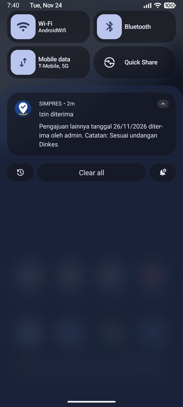 | 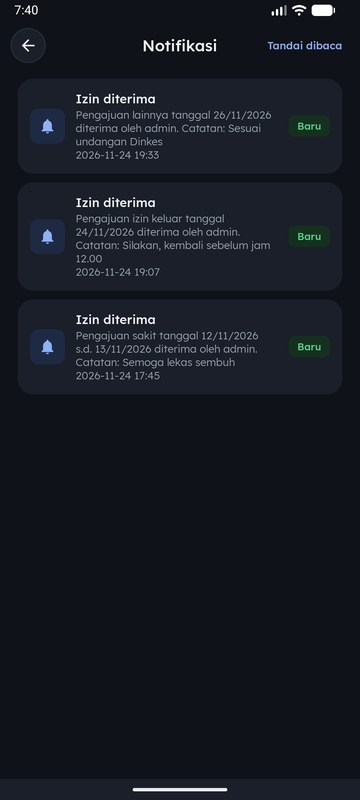 |

Cara kerjanya:
1. Admin memutuskan pengajuan di Admin Web. Server menyimpan notifikasi untuk pegawai itu (tabel `user_notifications`).
2. Di HP, `SyncWorker` (WorkManager, `app/.../data/Background.kt`) berjalan di latar belakang: satu menit setelah aplikasi
   ditutup, lalu setiap 15 menit, selama ada internet.
3. Worker mengambil `GET /api/notifications`. Notifikasi yang lebih baru dari yang terakhir ditampilkan muncul sebagai
   notifikasi Android (kanal "Keputusan admin").
4. Worker yang sama juga mengirim antrean absensi offline, jadi absensi terkirim walaupun aplikasi tidak dibuka.

Syarat di HP: izin notifikasi (diminta saat pertama membuka Beranda di Android 13 ke atas). Jika ditolak, keputusan admin
tetap bisa dilihat di halaman Notifikasi. Langkah berikutnya: Firebase Cloud Messaging supaya notifikasi datang seketika.
Server sudah menyimpan token perangkat (`POST /api/device-token`), tinggal proyek Firebase dan kunci servernya.

### Video pengujian per peran

Setiap peran diuji terpisah dan direkam video. Setiap langkah dicek otomatis dari layar.
Total **70 dari 70 langkah lulus**. Fitur yang diuji dan gambar untuk setiap langkah per peran ada di
[docs/HASIL_PENGUJIAN.md](docs/HASIL_PENGUJIAN.md). Klik GIF untuk membuka video lengkapnya.

| Pegawai non-shift | Pegawai shift | Petugas lapangan |
|---|---|---|
| <a href="docs/videos/1_pegawai_nonshift.mp4">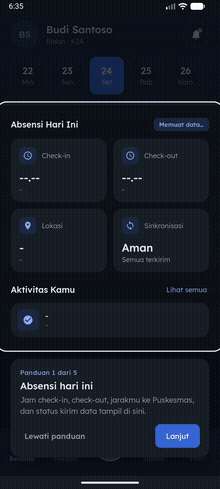</a> | <a href="docs/videos/2_pegawai_shift.mp4">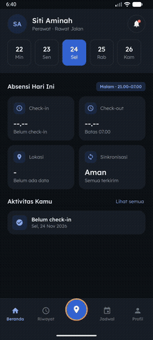</a> | <a href="docs/videos/3_petugas_lapangan.mp4">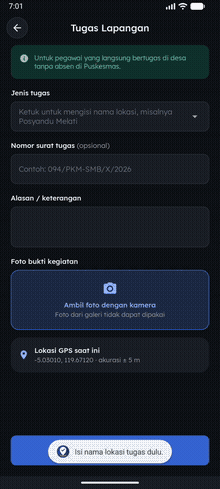</a> |
| Login, jadwal, check-in dan terlambat, check-in ganda, riwayat, izin keluar, check-out, notifikasi, profil (17/17) | Shift Malam, jadwal bergantian, luar radius dengan peta, koreksi absensi, cuti, check-out offline (12/12) | Luar radius, mode tugas lapangan, izin kamera dan foto, riwayat lapangan, check-in (10/10) |

| Notifikasi HP dan sinkronisasi | Integrasi aplikasi ↔ web |
|---|---|
| <a href="docs/videos/6_notifikasi_dan_sinkronisasi.mp4">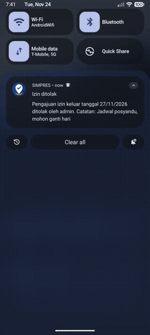</a> | <a href="docs/videos/5_integrasi_aplikasi_web.mp4">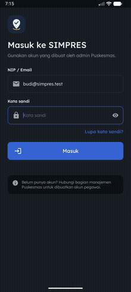</a> |
| Notifikasi keputusan admin saat aplikasi ditutup, antrean offline terkirim di latar belakang (5/5) | Keputusan admin tampil di HP setiap pegawai (5/5) |

| Admin Web |
|---|
| <a href="docs/videos/4_admin_web.mp4">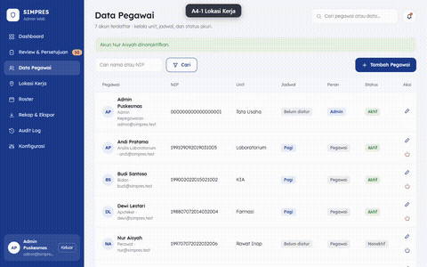</a> |
| Login, dashboard, kelola pegawai, lokasi, roster, terima/tolak pengajuan, rekap CSV, audit log, konfigurasi (21/21) |

### Bug yang ditemukan dan diperbaiki

17 bug ditemukan selama pengujian. Penjelasan lengkap tiap bug (gejala, bagian kode yang salah, penyebab, cara
perbaikan, dan screenshot sebelum/sesudah) ada di [docs/BUG_DAN_PERBAIKAN.md](docs/BUG_DAN_PERBAIKAN.md).

| No | Bug | Perbaikan |
|---|---|---|
| B01 | Server tidak bisa dihubungi dari HP asli | Alamat API untuk HP asli dan APK rilis dipisah dari alamat emulator |
| B02 | Slider check-out muncul sebentar di Beranda | Slider hanya tampil setelah check-in |
| B03 | Tulisan contoh desain muncul sebelum data asli | Beranda memakai data terakhir atau tanda kosong |
| B04 | Lupa kata sandi tidak mengirim apa pun, email yang tampil email contoh | API `POST /api/forgot-password`, email, dan halaman sandi baru |
| B05 | Email lupa sandi sebagian berbahasa Inggris | Terjemahan di `lang/id.json` |
| B06 | Tautan dan CSS Admin Web rusak saat dibuka dari luar laptop | Laravel memakai HTTPS di belakang proxy |
| B07 | Peta check-in hanya gambar hiasan | Peta asli OpenStreetMap |
| B08 | Peta tidak bisa digeser, zoom selalu ke tengah | Geser satu jari, zoom tetap di posisi geseran |
| B09 | Peta kosong sebagian di jaringan lambat | Unduh paralel, unduh utuh, coba ulang |
| B10 | Formulir izin tidak punya pilihan Cuti | Pilihan Cuti ditambahkan |
| B11 | Layar "Pengajuan terkirim" menampilkan data contoh | Menampilkan data pengajuan yang baru dikirim |
| B12 | Formulir tugas lapangan menampilkan lokasi contoh | GPS asli, nama lokasi wajib diisi |
| B13 | Absensi dari antrean offline tercatat `online` | Aplikasi mengirim `source=offline` |
| B14 | Halaman Koreksi Absensi tidak bisa dibuka | Menu Koreksi Absensi di Profil |
| B15 | Aplikasi crash saat ambil foto tugas lapangan | Izin kamera diminta sebelum kamera dibuka |
| B16 | Server mati sendiri | Server dijalankan di terminal sendiri |
| B17 | Keputusan admin tidak muncul sebagai notifikasi di HP | Notifikasi HP lewat WorkManager |

| Contoh bug | Sebelum | Sesudah |
|---|---|---|
| B04 Lupa sandi | 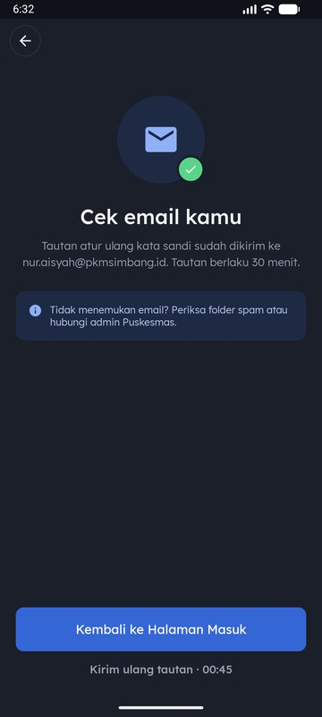 | 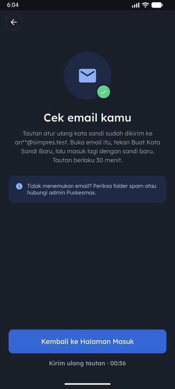 |
| B07 Peta | 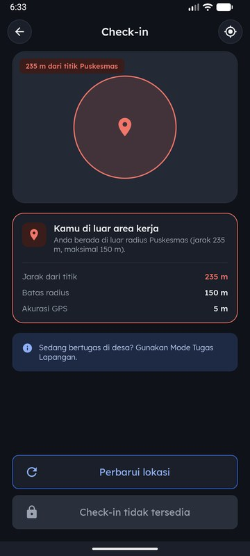 | 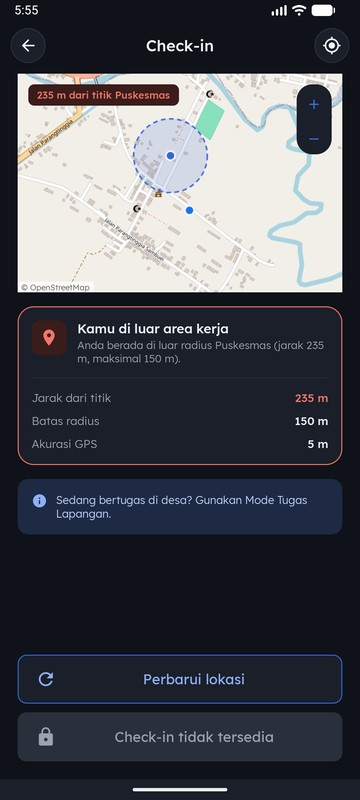 |
| B11 Pengajuan terkirim | 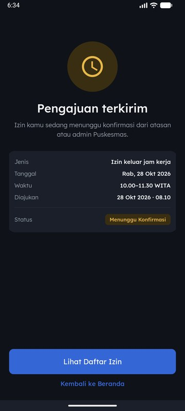 | 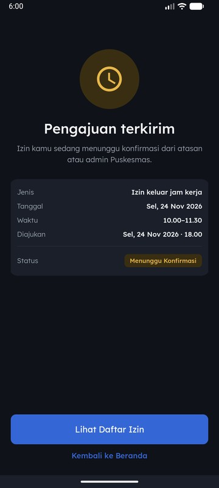 |
| B14 Menu koreksi | 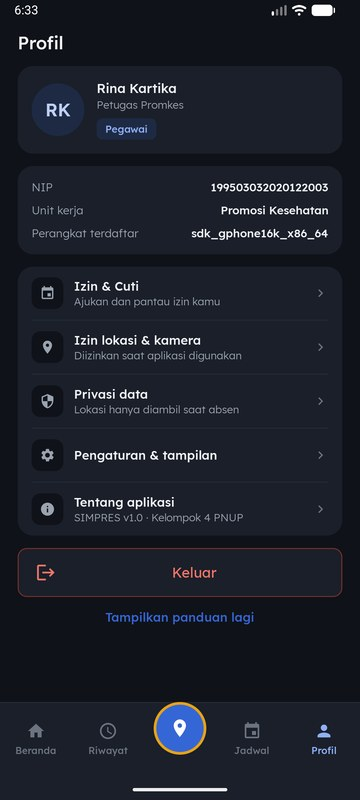 | 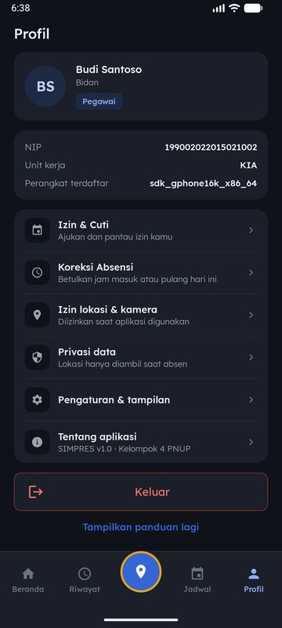 |

### Screenshot aplikasi Android

| Onboarding | Panduan awal | Beranda | Peta check-in |
|---|---|---|---|
| 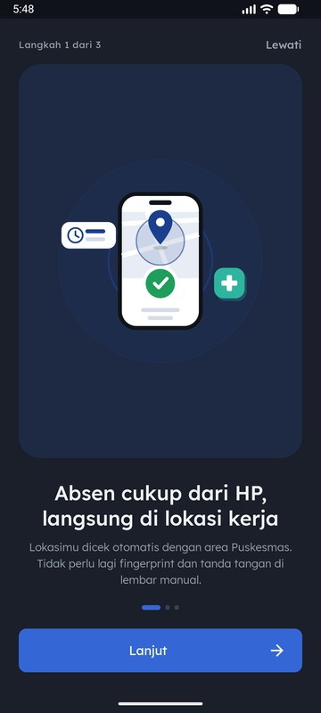 | 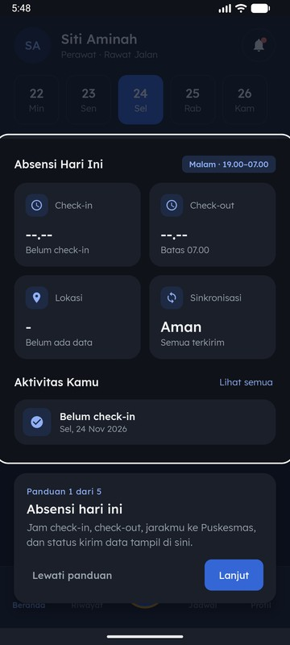 | 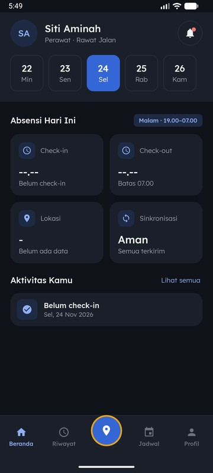 | 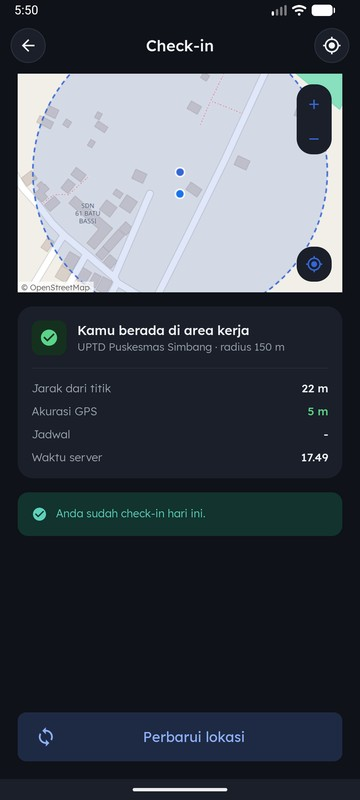 |

| Check-in berhasil | Geser check-out | Di luar radius | Tersimpan offline |
|---|---|---|---|
| 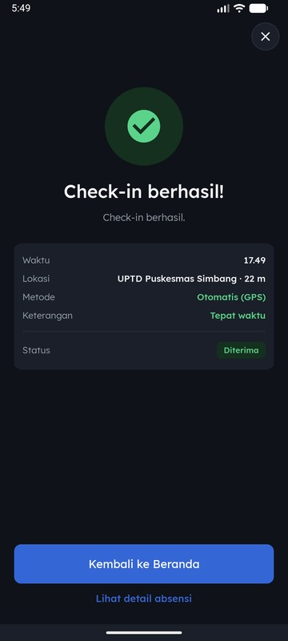 | 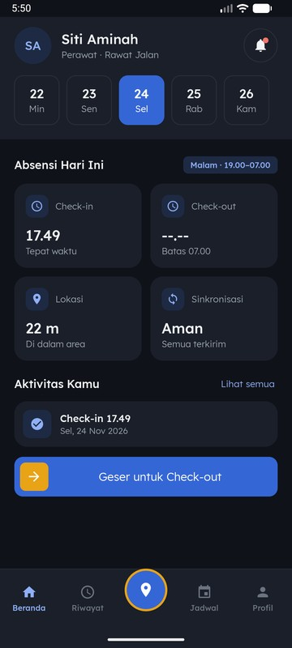 |  | 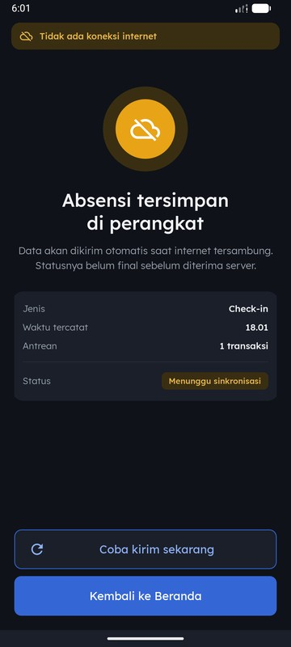 |

| Riwayat | Jadwal non-shift | Jadwal shift | Notifikasi |
|---|---|---|---|
| 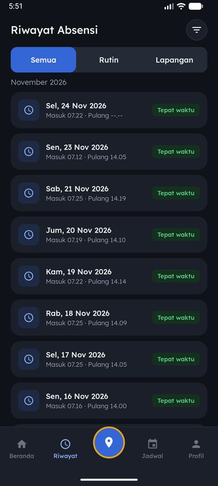 | 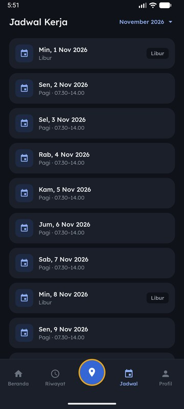 | 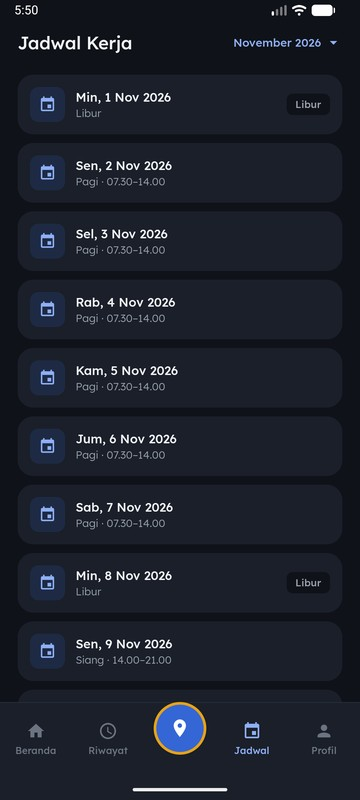 | 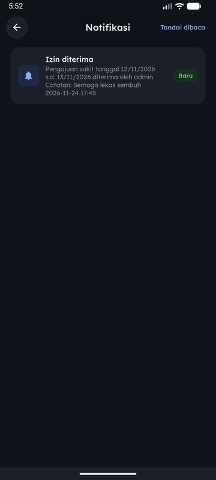 |

| Daftar izin | Formulir cuti | Pengajuan terkirim | Tugas lapangan |
|---|---|---|---|
| 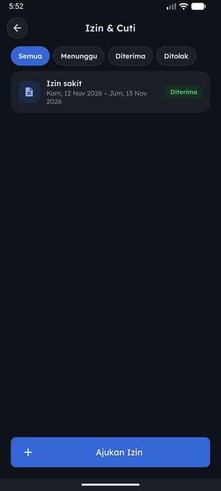 | 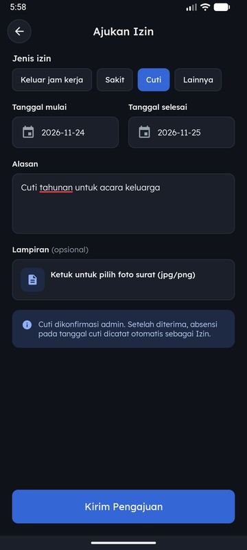 |  | 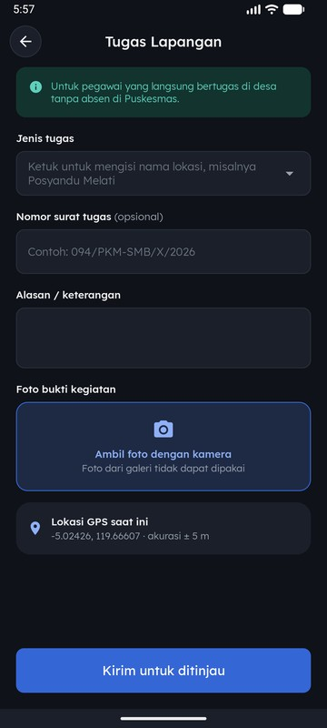 |

| Riwayat tugas lapangan | Lupa kata sandi | Cek email | Profil |
|---|---|---|---|
| 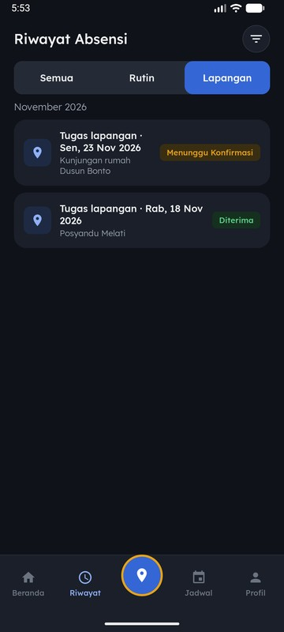 | 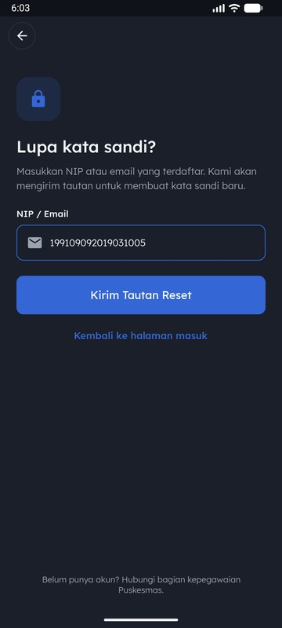 |  |  |

### Screenshot Admin Web

| Dashboard | Data Pegawai | Lokasi Kerja |
|---|---|---|
|  |  |  |

| Roster | Review izin | Review tugas lapangan |
|---|---|---|
|  |  |  |

| Rekap & Ekspor | Audit Log | Konfigurasi |
|---|---|---|
|  |  |  |

| Atur ulang kata sandi |
|---|
|  |

### Belum dikerjakan (lanjut ke v1.0.0)

- Firebase Cloud Messaging supaya notifikasi datang seketika (menunggu proyek Firebase).
- Kamera CameraX, token login di Android Keystore, dan penguncian perangkat terdaftar.
- Hosting permanen dengan domain dan HTTPS.
- Jam absensi offline masih memakai jam saat data terkirim, belum jam saat disimpan di HP.
- Pengujian bersama pegawai Puskesmas dan evaluasi mitra.

## v1.0.0 – Rilis (rencana)

Minggu 15 (2 Desember 2026). Checkpoint: fitur utama final, CRUD, basis data, REST API, pengujian sistem, video, laporan PjBL.

- Backend dan Admin Web dipasang di hosting dengan HTTPS (panduan di `backend/DEPLOY.md`).
- APK rilis untuk pegawai, akun contoh diganti akun asli.
- Video demonstrasi dan laporan akhir PjBL.

---

## Menjalankan proyek

### Backend dan Admin Web
1. Jalankan MySQL (Laragon), lalu buat database dari `docs/database/simpres.sql`.
2. Di folder `backend`: `composer install`, salin `.env.example` menjadi `.env`, isi koneksi database, lalu `php artisan key:generate` dan `php artisan migrate`.
3. Jalankan `php artisan serve`. Admin Web ada di `http://127.0.0.1:8000/admin`.
4. Test otomatis: `php artisan test` (database `simpres_test`, dibuat dengan `tests/buat-database-test.ps1`).

### Aplikasi Android
1. Android Studio → **Open** → folder `SIMPRES`, tunggu Gradle sync.
2. Emulator memakai server laptop lewat `http://10.0.2.2:8000/api/`. Untuk HP asli atau hosting, isi
   `simpres.apiUrl=https://alamat-server/api/` di `local.properties`.
3. Jalankan konfigurasi `app` (Android 8.0 ke atas).

Akun contoh dari data awal (ganti sebelum online): `admin@simpres.test`, `siti@simpres.test`, `budi@simpres.test`, sandi `simpres123`.

## Struktur kode Android

| Folder | Isi |
|---|---|
| `data/` | `Api.kt` (Retrofit dan model), `Session.kt` (token dan antrean offline), `Locator.kt` (GPS), `Format.kt` (format tanggal dan status) |
| `ui/BaseFragment.kt` | Navigasi bersama, bottom navigation, cek koneksi, coroutine per halaman |
| `ui/<fitur>/*Screens.kt` | Satu Fragment per halaman: auth, home, attendance, leave, settings |
| `ui/CoachMarks.kt` | Panduan awal yang menyorot tombol penting, tampil sekali |
| `res/raw/` | Animasi Lottie intro dan onboarding |
| `res/layout` | 29 layout halaman + komponen baris daftar |

## Daftar halaman dan layout Android

| Halaman | Layout | | Halaman | Layout |
|---|---|---|---|---|
| 01 Splash | `fragment_splash` | | 16 Profil | `fragment_profile` (+ `dialog_logout`) |
| 02 Onboarding | `fragment_onboarding` | | 17 Konfigurasi | `fragment_config` |
| 03 Login | `fragment_login` | | 18 Lupa Kata Sandi | `fragment_forgot_password` |
| 04 Beranda | `fragment_home` | | 19 Tautan Terkirim | `fragment_reset_sent` |
| 05 Check-in | `fragment_checkin` | | 20 Check-out Berhasil | `fragment_checkout_success` |
| 06 Di Luar Radius | `fragment_outside_radius` | | 21 Izin & Cuti | `fragment_leave_list` |
| 07 Foto Wajah (opsional) | `fragment_face_photo` | | 22 + 23 Ajukan Izin | `fragment_leave_form` |
| 08 Check-in Berhasil | `fragment_checkin_success` | | 24 Izin Terkirim | `fragment_leave_sent` |
| 09 Tersimpan Offline | `fragment_offline_saved` | | 25 Detail Izin – Diterima | `fragment_leave_accepted` |
| 10 Tugas Lapangan | `fragment_field_duty` | | 26 Detail Izin – Ditolak | `fragment_leave_rejected` |
| 11 Kamera Bukti | `fragment_camera` | | 27 Notifikasi | `fragment_notification` |
| 12 Riwayat | `fragment_history` | | 28 Antrean Sinkronisasi | `fragment_sync` |
| 13 Detail Absensi | `fragment_attendance_detail` | | 29 Izin & Privasi | `fragment_privacy` |
| 14 Jadwal Kerja | `fragment_schedule` | | 30 Tentang Aplikasi | `fragment_about` |
| 15 Ajukan Koreksi | `fragment_correction` | | | |

---

PjBL Aplikasi Mobile · Kelompok 4 · Mitra UPTD Puskesmas Simbang
