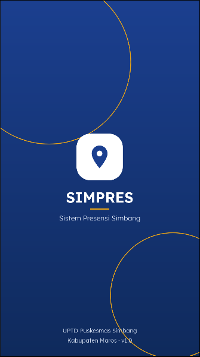
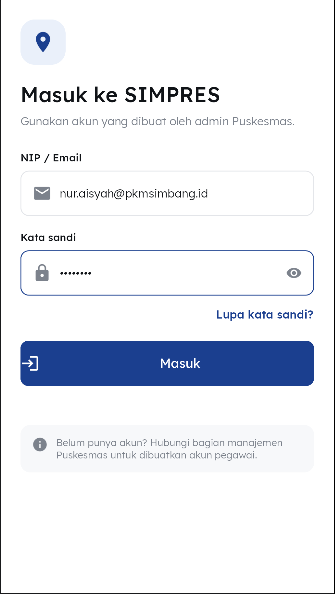
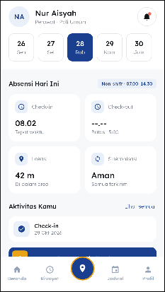
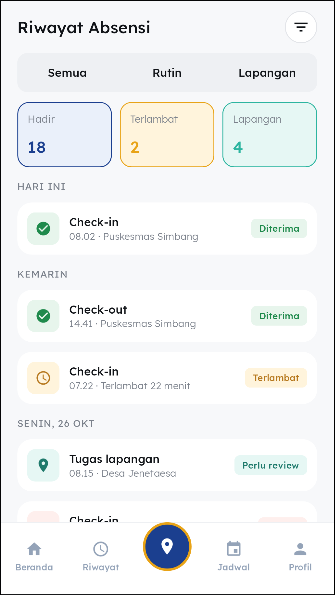
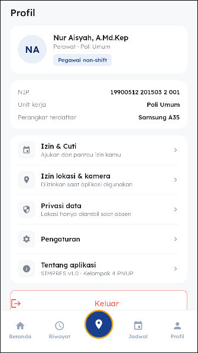

# SIMPRES – Android (XML + Kotlin)

UI of the SIMPRES auto-attendance app for UPTD Puskesmas Simbang, built from the Figma file
**SIMPRES – Admin Web** (Light Mode page for the light theme, Dark Mode page for the dark theme).

## Screenshots

Layout previews from Android Studio (light theme).

| Splash | Login | Beranda | Riwayat | Profil |
|---|---|---|---|---|
|  |  |  |  |  |

## Open the project
1. Android Studio (Koala or newer) → **Open** → select this `SIMPRES` folder.
2. Let Gradle sync (needs internet the first time), then run the `app` configuration on a device/emulator (Android 8.0+).

## What is inside
| Package / folder | Content |
|---|---|
| `res/layout` | 29 screen layouts + `view_bottom_nav` + `dialog_logout` + `activity_main` |
| `res/navigation/nav_graph.xml` | Navigation graph with all 29 destinations |
| `res/values` · `res/values-night` | Colors, text styles, theme – the night folder is the Figma Dark Mode palette |
| `res/drawable` | Backgrounds (cards, chips, buttons, inputs) and the icon set |
| `res/font` | Lexend (Light, Regular, Medium, SemiBold – SIL Open Font License) |
| `ui/BaseFragment.kt` | Shared navigation helpers, bottom-nav wiring, online check |
| `ui/<feature>/*Screens.kt` | One small Fragment per screen (click handling and navigation only) |

Dark mode follows the system setting automatically (`Theme.AppCompat.DayNight`).

## Figma screen → layout
| Figma | Layout | | Figma | Layout |
|---|---|---|---|---|
| 01 Splash | `fragment_splash` | | 16 Profil | `fragment_profile` (+ `dialog_logout` = 31) |
| 02 Onboarding | `fragment_onboarding` | | 17 Konfigurasi | `fragment_config` |
| 03 Login | `fragment_login` | | 18 Lupa Kata Sandi | `fragment_forgot_password` |
| 04 Beranda | `fragment_home` | | 19 Tautan Terkirim | `fragment_reset_sent` |
| 05 Check-in | `fragment_checkin` | | 20 Check-out Berhasil | `fragment_checkout_success` |
| 06 Di Luar Radius | `fragment_outside_radius` | | 21 Izin & Cuti | `fragment_leave_list` |
| 07 Foto Wajah (opsional) | `fragment_face_photo` | | 22 + 23 Ajukan Izin | `fragment_leave_form` (chips switch the field group) |
| 08 Check-in Berhasil | `fragment_checkin_success` | | 24 Izin Terkirim | `fragment_leave_sent` |
| 09 Tersimpan Offline | `fragment_offline_saved` | | 25 Detail Izin – Diterima | `fragment_leave_accepted` |
| 10 Tugas Lapangan | `fragment_field_duty` | | 26 Detail Izin – Ditolak | `fragment_leave_rejected` |
| 11 Kamera Bukti | `fragment_camera` | | 27 Notifikasi | `fragment_notification` |
| 12 Riwayat | `fragment_history` | | 28 Antrean Sinkronisasi | `fragment_sync` |
| 13 Detail Absensi | `fragment_attendance_detail` | | 29 Izin & Privasi | `fragment_privacy` |
| 14 Jadwal Kerja | `fragment_schedule` | | 30 Tentang Aplikasi | `fragment_about` |
| 15 Ajukan Koreksi | `fragment_correction` | | | |

## Good to know
- **Sample data**: texts, names and times are the example content from Figma, so the app looks like the design.
  Replace them with real data when the backend/Room layer is added.
- **Geofence demo**: `Geofence.distanceM` (`ui/attendance/AttendanceScreens.kt`) is 42 m (inside). Set it to 212 to see the
  "Di Luar Radius" flow. Inside the radius the check-in is recorded automatically; offline shows "Tersimpan Offline".
- **Placeholders**: the map (05, 06, 13) and the camera preview (07, 11) are static drawings. Wire in Google Maps / CameraX there.
- **Not included**: the admin web screens (A1–A8, 1440 px) are a website, not part of the Android app.
