# Bug yang Ditemukan dan Perbaikannya

Catatan semua bug yang ditemukan selama pengujian SIMPRES (Minggu 14, 24 November 2026): gejalanya, bagian kode yang
salah, penyebabnya, cara memperbaikinya, dan bukti sesudah diperbaiki.

Bug ditemukan dari tiga sumber:
- pemakaian langsung aplikasi di HP dan emulator,
- pengujian per pengguna yang direkam video (lihat [HASIL_PENGUJIAN.md](HASIL_PENGUJIAN.md)),
- test otomatis backend (`php artisan test`).

Screenshot **sebelum** diambil dari versi aplikasi sebelum perbaikan (commit `c455470`), screenshot **sesudah** dari versi terbaru.

## Ringkasan

| No | Bug | Bagian | Jenis | Status |
|---|---|---|---|---|
| [B01](#b01-server-tidak-bisa-dihubungi-dari-hp-asli) | Server tidak bisa dihubungi dari HP asli | Aplikasi (konfigurasi) | Koneksi | Diperbaiki |
| [B02](#b02-slider-check-out-muncul-sebentar-di-beranda) | Slider check-out muncul sebentar di Beranda | Aplikasi | Tampilan | Diperbaiki |
| [B03](#b03-tulisan-contoh-desain-muncul-sebelum-data-asli) | Tulisan contoh desain muncul sebelum data asli | Aplikasi | Data tidak keluar | Diperbaiki |
| [B04](#b04-lupa-kata-sandi-tidak-mengirim-apa-pun) | Lupa kata sandi tidak mengirim apa pun, email yang tampil email contoh | Aplikasi + server | Fitur tidak jalan | Diperbaiki |
| [B05](#b05-email-lupa-sandi-sebagian-berbahasa-inggris) | Email lupa sandi sebagian berbahasa Inggris | Server | Tampilan | Diperbaiki |
| [B06](#b06-tautan-dan-tampilan-admin-web-rusak-saat-dibuka-dari-luar) | Tautan dan tampilan Admin Web rusak saat dibuka dari luar laptop | Server | Koneksi | Diperbaiki |
| [B07](#b07-peta-check-in-hanya-gambar-hiasan) | Peta check-in hanya gambar hiasan | Aplikasi | Data tidak keluar | Diperbaiki |
| [B08](#b08-peta-tidak-bisa-digeser-zoom-selalu-ke-tengah) | Peta tidak bisa digeser, zoom selalu kembali ke tengah | Aplikasi | Fitur kurang | Diperbaiki |
| [B09](#b09-peta-kosong-sebagian-di-jaringan-lambat) | Peta kosong sebagian atau tidak muncul di jaringan lambat | Aplikasi | Data tidak keluar | Diperbaiki |
| [B10](#b10-formulir-izin-tidak-punya-pilihan-cuti) | Formulir izin tidak punya pilihan Cuti | Aplikasi | Fitur kurang | Diperbaiki |
| [B11](#b11-layar-pengajuan-terkirim-menampilkan-data-contoh) | Layar "Pengajuan terkirim" menampilkan data contoh | Aplikasi | Data tidak keluar | Diperbaiki |
| [B12](#b12-formulir-tugas-lapangan-menampilkan-lokasi-contoh) | Formulir tugas lapangan menampilkan lokasi contoh | Aplikasi | Data tidak keluar | Diperbaiki |
| [B13](#b13-absensi-dari-antrean-offline-tercatat-online) | Absensi dari antrean offline tercatat `online` | Aplikasi + server | Data salah | Diperbaiki |
| [B14](#b14-halaman-koreksi-absensi-tidak-bisa-dibuka) | Halaman Koreksi Absensi tidak bisa dibuka dari mana pun | Aplikasi | Fitur tidak jalan | Diperbaiki |
| [B15](#b15-aplikasi-tertutup-crash-saat-ambil-foto-tugas-lapangan) | Aplikasi tertutup (crash) saat Ambil foto tugas lapangan | Aplikasi | Crash | Diperbaiki |
| [B16](#b16-server-mati-sendiri) | Server mati sendiri | Server (cara menjalankan) | Operasional | Diperbaiki |

---

## B01. Server tidak bisa dihubungi dari HP asli

**Gejala:** di HP asli muncul "Server tidak bisa dihubungi. Periksa koneksi internet lalu coba lagi", padahal di emulator lancar.

**Bagian yang salah:** `app/build.gradle.kts` baris 15, alamat API bawaan `http://10.0.2.2:8000/api/`.

**Penyebab:** `10.0.2.2` adalah alamat khusus emulator untuk menghubungi laptop. HP asli tidak mengenal alamat itu.

**Perbaikan:**
- Untuk pengujian lewat kabel USB: `adb reverse tcp:8000 tcp:8000`, lalu alamat API diisi `http://127.0.0.1:8000/api/`
  di `local.properties` (`simpres.apiUrl`).
- Untuk APK rilis: alamat server publik diisi terpisah (`simpres.releaseApiUrl`, baris 18 dan 49), jadi APK yang dibagikan
  langsung memakai server online.

```kotlin
val apiUrl = localProps.getProperty("simpres.apiUrl") ?: "http://10.0.2.2:8000/api/"
val releaseApiUrl = localProps.getProperty("simpres.releaseApiUrl") ?: apiUrl
```

---

## B02. Slider check-out muncul sebentar di Beranda

**Gejala:** setiap pindah dari halaman lain ke Beranda, slider "Geser untuk Check-out" muncul sebentar lalu hilang. Pengguna
mengira sudah tidak bisa absen.

**Bagian yang salah:** `app/src/main/res/layout/fragment_home.xml` baris 516 (`swipeCheckOut`) tampil secara bawaan.

**Penyebab:** slider tampil sejak layout dibuat, lalu baru disembunyikan setelah data dari server datang.

**Perbaikan:** slider disembunyikan secara bawaan (`android:visibility="gone"`), lalu hanya ditampilkan jika data server
menyatakan sudah check-in dan belum check-out. Panduan awal juga melewati slider yang tidak tampil.

---

## B03. Tulisan contoh desain muncul sebelum data asli

**Gejala:** saat membuka Beranda, tulisan contoh dari desain (status "Check-in") tampil dulu, lalu berubah menjadi
"Belum check-in". Data tampak berganti-ganti.

**Bagian yang salah:** `app/src/main/java/com/simpres/app/ui/home/HomeScreens.kt`, fungsi `loadToday` (baris 86).

**Penyebab:** layout masih berisi teks contoh dari desain, dan teks itu terlihat sampai data server selesai dimuat.

**Perbaikan:** sebelum data datang, Beranda langsung menampilkan data terakhir yang tersimpan (`lastToday`). Jika belum ada,
yang tampil tanda kosong (`--.--`, "Memuat...") lewat `showPlaceholders` (baris 101), bukan teks contoh.

---

## B04. Lupa kata sandi tidak mengirim apa pun

| Sebelum | Sesudah |
|---|---|
| 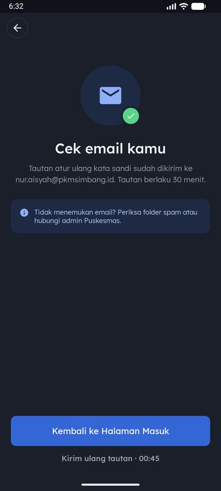 | 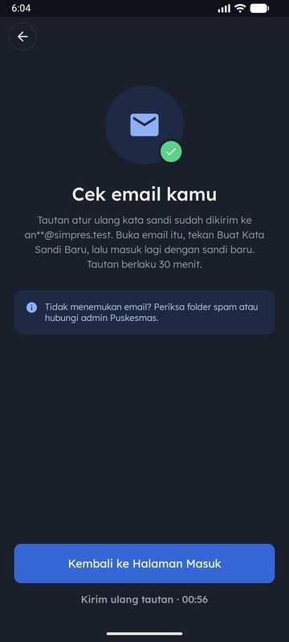 |

**Gejala:** setelah menekan "Kirim Tautan Reset", layar mengatakan tautan sudah dikirim ke `nur.aisyah@pkmsimbang.id`,
apa pun yang diketik. Tidak ada email yang terkirim.

**Bagian yang salah:**
- `app/.../ui/auth/AuthScreens.kt`, `ForgotPasswordFragment` (baris 201). Tombol hanya pindah halaman tanpa menghubungi server.
- `app/src/main/res/values/strings.xml`. Email di layar hasil berupa teks tetap.
- Server belum punya endpoint lupa sandi.

**Perbaikan:**
- Server: endpoint baru `POST /api/forgot-password` (`AuthController::forgotPassword`, baris 45). Endpoint ini mencari akun
  lewat NIP atau email, mengirim tautan memakai fitur reset bawaan Laravel, dan mengembalikan email yang disamarkan
  (`bu**@simpres.test`).
- Halaman web baru `/reset-password/{token}` (`PasswordResetController`) untuk membuat sandi baru. Setelah sandi diganti,
  semua login lama dikeluarkan.
- Aplikasi: tombol memanggil API. Layar hasil menampilkan email dari server, dengan tombol kirim ulang setelah 60 detik.
- Test: `tests/Feature/ForgotPasswordTest.php` (4 test).

---

## B05. Email lupa sandi sebagian berbahasa Inggris

**Gejala:** isi email sudah berbahasa Indonesia, tapi baris bawahnya masih "If you're having trouble clicking the button...".

**Bagian yang salah:** template email bawaan Laravel memakai teks bahasa Inggris.

**Perbaikan:** terjemahan ditambahkan di `backend/lang/id.json`.

---

## B06. Tautan dan tampilan Admin Web rusak saat dibuka dari luar

**Gejala:** saat server dibuka lewat alamat publik (HTTPS), tautan email dan file CSS Admin Web memakai `http://localhost`,
sehingga tampilan berantakan dan tautan tidak bisa dibuka.

**Bagian yang salah:** `backend/bootstrap/app.php`. Laravel tidak tahu bahwa ia berada di belakang proxy HTTPS.

**Perbaikan:** `$middleware->trustProxies(at: '*')` (baris 28) dan `APP_URL` diisi alamat publik, sehingga semua tautan memakai HTTPS.

---

## B07. Peta check-in hanya gambar hiasan

| Sebelum | Sesudah |
|---|---|
| 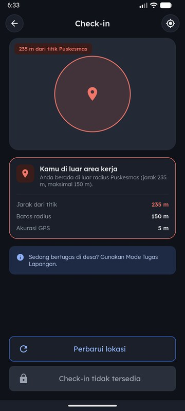 | 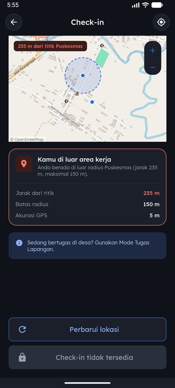 |

**Gejala:** kotak peta di halaman check-in dan di luar radius hanya berisi lingkaran dan pin hiasan. Jalan dan bangunan
sekitar tidak tampil, dan posisi pegawai tidak terlihat.

**Bagian yang salah:** `fragment_checkin.xml` dan `fragment_outside_radius.xml` hanya memakai latar `@drawable/bg_map`.

**Perbaikan:** file baru `ui/attendance/OsmMap.kt` menggambar peta asli dari OpenStreetMap (tanpa API key dan tanpa
library tambahan). Isinya lingkaran radius 150 m, titik Puskesmas, dan titik biru posisi pegawai.

---

## B08. Peta tidak bisa digeser, zoom selalu ke tengah

**Gejala:** peta hanya bisa di-zoom, dan zoom selalu menuju tengah. Peta tidak bisa digeser untuk melihat sekitar.

**Bagian yang salah:** `ui/attendance/AttendanceScreens.kt`, fungsi `showMap` (baris 64), yang hanya menyimpan tingkat zoom.

**Perbaikan:** posisi peta disimpan di `MapState` (baris 57). Satu jari menggeser peta, dua jari atau tombol +/− mengatur
zoom, dan posisi geseran tetap dipakai saat di-zoom.

---

## B09. Peta kosong sebagian di jaringan lambat

**Gejala:** ditemukan saat pengujian video. Di jaringan lambat, sebagian kotak peta berwarna gelap atau seluruh peta tidak muncul.

**Bagian yang salah:** `ui/attendance/OsmMap.kt`, fungsi `tile` (baris 139).

**Penyebab:**
1. Potongan peta (tile) diunduh satu per satu, jadi lama.
2. Gambar dibaca langsung dari koneksi. Jika koneksi terputus di tengah, gambar terbaca setengah dan sisanya kosong.
3. Satu tile gagal membuat seluruh peta batal.

**Perbaikan:**
- Semua tile diunduh bersamaan (`async` dan `awaitAll`, baris 96).
- Isi diunduh utuh dulu (`bytes()`), lalu dicoba ulang sekali jika gagal.
- Tile yang tetap gagal diberi warna dasar peta (`LAND`, baris 101), dan peta tetap tampil.

---

## B10. Formulir izin tidak punya pilihan Cuti

| Sebelum | Sesudah |
|---|---|
| 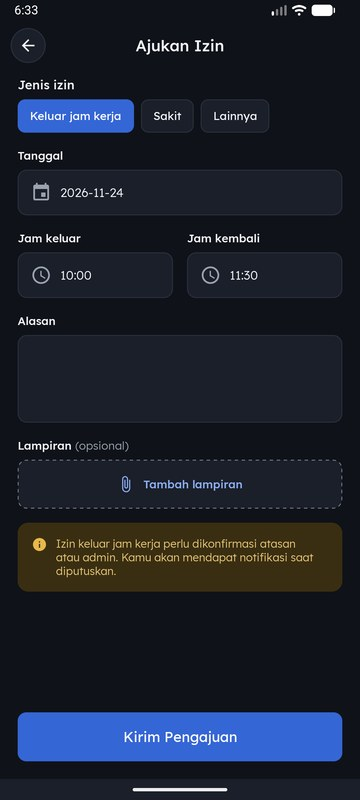 | 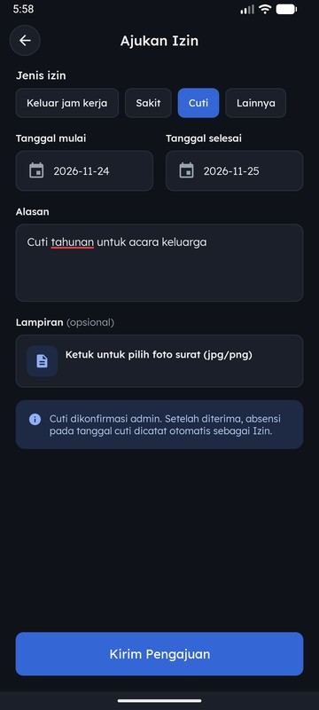 |

**Gejala:** pilihan jenis izin hanya "Keluar jam kerja", "Sakit", dan "Lainnya", padahal server dan Admin Web mendukung cuti.

**Bagian yang salah:** `fragment_leave_form.xml` dan `ui/leave/LeaveScreens.kt`, `LeaveFormFragment` (baris 98).

**Perbaikan:** pilihan **Cuti** ditambahkan (baris 106), dengan tanggal mulai dan selesai, alasan, dan lampiran opsional.
Label formulir menyesuaikan jenis izin. Ditemukan juga teks "(wajib jika > 1 hari)" untuk surat dokter, padahal server
selalu mewajibkannya, jadi teks itu diganti "(wajib)".

---

## B11. Layar "Pengajuan terkirim" menampilkan data contoh

| Sebelum | Sesudah |
|---|---|
| 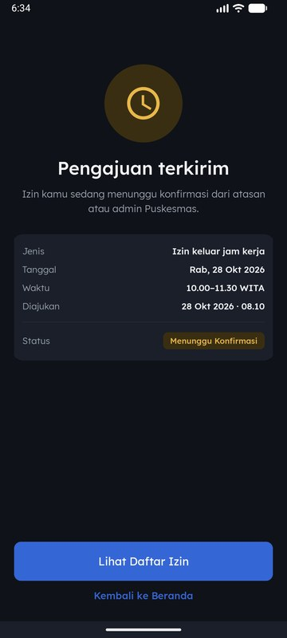 | 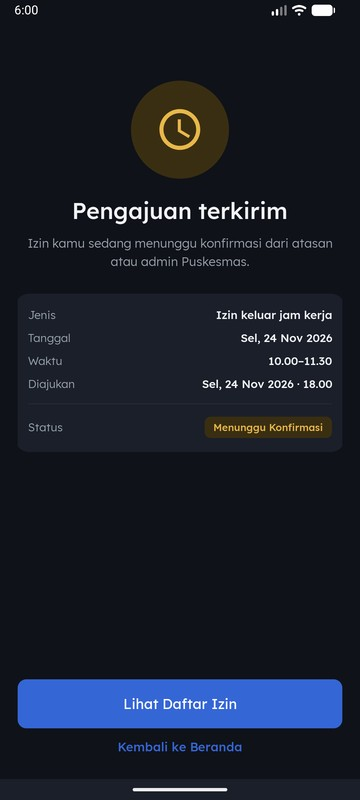 |

**Gejala:** apa pun yang dikirim, layar selalu menampilkan "Izin keluar jam kerja, Rab 28 Okt 2026, 10.00–11.30 WITA".

**Bagian yang salah:** `ui/leave/LeaveScreens.kt`, `LeaveSentFragment` (baris 229), yang tidak mengisi data. Layout masih berisi teks contoh.

**Perbaikan:** data izin yang dikembalikan server disimpan (`LeaveSentFragment.last`, baris 213), lalu ditampilkan:
jenis, tanggal, jam (atau "Sepanjang hari"), dan waktu pengajuan.

---

## B12. Formulir tugas lapangan menampilkan lokasi contoh

| Sebelum | Sesudah |
|---|---|
| 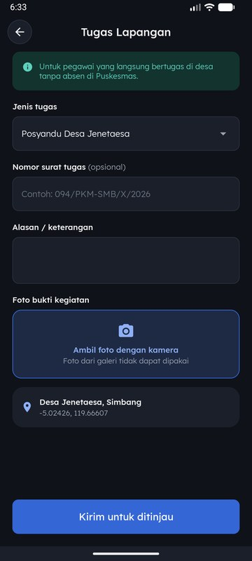 | 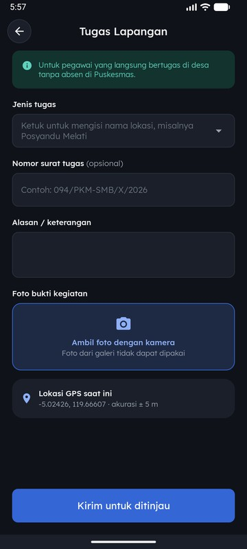 |

**Gejala:** formulir sudah terisi "Posyandu Desa Jenetaesa", dan lokasi GPS tertulis "Desa Jenetaesa, Simbang", walaupun
pegawai berada di tempat lain. Jika pegawai langsung menekan Kirim, nama lokasi contoh ikut tersimpan.

**Bagian yang salah:** `fragment_field_duty.xml` (teks contoh desain) dan `FieldDutyFragment` (`AttendanceScreens.kt` baris 316).

**Perbaikan:**
- Nama lokasi dikosongkan dengan petunjuk "Ketuk untuk mengisi nama lokasi", dan wajib diisi (baris 362).
- Kotak GPS menampilkan koordinat dan akurasi asli dari HP (baris 358), atau pesan jika GPS gagal.

---

## B13. Absensi dari antrean offline tercatat online

**Gejala:** absensi yang disimpan saat tidak ada sinyal, lalu terkirim belakangan, tercatat `source = online` di database.
Admin tidak bisa membedakannya.

**Bagian yang salah:** `backend/app/Http/Controllers/Api/AttendanceController.php` baris 84 selalu mengisi `'online'`.
Aplikasi juga tidak memberi tahu asal datanya.

**Perbaikan:**
- Aplikasi menandai data antrean dengan `source = "offline"` (`AttendanceScreens.kt` baris 220).
- Server menerima kolom `source` (`CheckInRequest.php` baris 24) dan menyimpannya.
- Test: `test_check_in_dari_antrean_offline_tercatat_offline`.

---

## B14. Halaman Koreksi Absensi tidak bisa dibuka

| Sebelum | Sesudah |
|---|---|
| 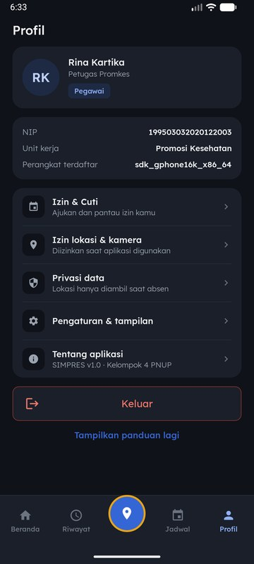 | 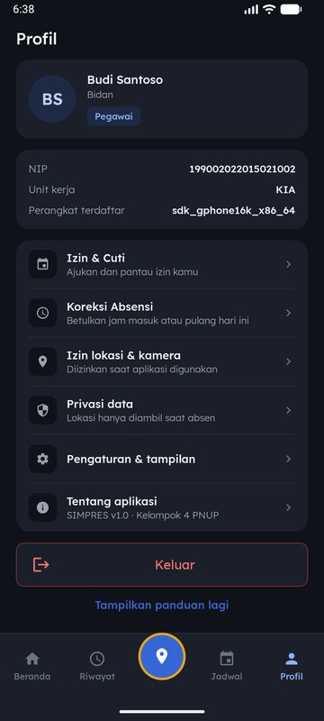 |

**Gejala:** ditemukan saat menyusun pengujian per pengguna. Halaman Koreksi Absensi sudah dibuat
(`CorrectionFragment`, `HomeScreens.kt` baris 262), tapi tidak ada tombol atau menu yang membukanya.

**Bagian yang salah:** menu Profil (`fragment_profile.xml`) tidak punya pintu masuk ke `correctionFragment`.

**Perbaikan:** menu **Koreksi Absensi** ditambahkan di Profil, di bawah Izin & Cuti (`fragment_profile.xml` baris 212,
`HomeScreens.kt` baris 351). Sudah diuji di video pegawai shift (D3-0, D3-1).

---

## B15. Aplikasi tertutup (crash) saat ambil foto tugas lapangan

| Sesudah: izin kamera diminta, foto terpasang |
|---|
| 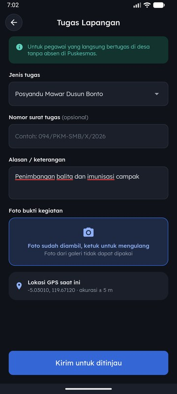 |

**Gejala:** ditemukan saat pengujian video petugas lapangan. Saat menekan "Ambil foto dengan kamera", aplikasi langsung
tertutup dan kembali ke layar utama HP. Log Android:

```
java.lang.SecurityException: Permission Denial: starting Intent { act=android.media.action.IMAGE_CAPTURE ... }
with revoked permission android.permission.CAMERA
```

**Bagian yang salah:** `FieldDutyFragment` (`AttendanceScreens.kt`). Kamera langsung dibuka tanpa meminta izin.

**Penyebab:** aplikasi mencantumkan izin `CAMERA` di `AndroidManifest.xml`. Dalam kondisi itu, Android melarang membuka
kamera bawaan sebelum izin kamera diberikan pengguna. Di pengujian sebelumnya izin kamera diberikan lewat perintah adb,
sehingga bug ini tidak kelihatan. Di HP pegawai yang baru memasang aplikasi, bug ini pasti terjadi.

**Perbaikan:** sebelum membuka kamera, aplikasi meminta izin kamera (`cameraPermission`, baris 349). Jika ditolak, muncul
pesan untuk mengaktifkannya di Pengaturan. Pembukaan kamera juga dibungkus `runCatching` (`openCamera`, baris 330),
jadi aplikasi tidak bisa crash di titik ini. Sudah diuji di video petugas lapangan (E2-2, E2-2b).

---

## B16. Server mati sendiri

**Gejala:** aplikasi dan Admin Web tiba-tiba tidak bisa dibuka.

**Penyebab:** server Laravel dijalankan dari panel pratinjau browser. Saat panel itu ditutup, server ikut berhenti.

**Perbaikan:** server dijalankan di jendela terminal sendiri dengan `php artisan serve` (4 worker, supaya bisa melayani
beberapa pengguna sekaligus). Server tetap hidup selama jendela itu terbuka.

---

## Kendala teknis saat pengujian (bukan bug aplikasi)

| Kendala | Penyebab | Solusi |
|---|---|---|
| `adb install` gagal di HP Xiaomi (`INSTALL_FAILED_VERIFICATION_FAILURE`) | Verifikasi pemasangan lewat USB di MIUI | APK disalin ke folder Download HP lalu dipasang manual |
| Build APK rilis gagal di tahap `lintVitalAnalyzeRelease` | Alat lint Android error sendiri (`Already disposed: MessageBus`) | Build rilis melewati lint: `-x lintVitalRelease` |
| Emulator kehilangan DNS setelah data dan Wi-Fi dimatikan lalu dinyalakan | DNS bawaan emulator macet | Emulator dijalankan ulang dengan `-dns-server 8.8.8.8,1.1.1.1` |

## Yang masih perlu diperhatikan

- **Jam absensi offline** masih memakai jam saat data terkirim, belum jam saat disimpan di HP. Perlu kolom waktu dari HP
  dan aturan batas waktu di server supaya tidak bisa dipalsukan.
- **Peta di jaringan sangat lambat** butuh beberapa detik sampai tampil. Selama menunggu, gambar hiasan tetap terlihat.
  Keputusan absensi tidak bergantung pada peta.
- Layout `fragment_attendance_detail`, `fragment_leave_accepted`, dan `fragment_leave_rejected` masih berisi data contoh,
  tapi saat ini tidak dibuka dari mana pun di aplikasi, jadi tidak terlihat oleh pengguna.
