# Hasil Pengujian per Peran

Pengujian 24 November 2026 dengan server dan data asli (Laravel + MySQL), aplikasi Android versi rilis di emulator,
dan Admin Web di Chrome. Setiap peran diuji terpisah dan direkam video. Setiap langkah dicek otomatis dari teks di layar,
lalu dicatat ✅ (lulus) atau ❌ (gagal). Gambar di bawah diambil dari video pada saat langkah itu dinyatakan lulus.
ID langkah mengikuti [SKEMA_PENGUJIAN.md](SKEMA_PENGUJIAN.md).

Video bisa diputar langsung di GitHub dengan membuka file `.mp4`.

## Ringkasan

| Peran / pengujian | Video | Lulus |
|---|---|---|
| Admin (Admin Web) | [4_admin_web.mp4](videos/4_admin_web.mp4) | 21/21 |
| Pegawai non-shift | [1_pegawai_nonshift.mp4](videos/1_pegawai_nonshift.mp4) | 17/17 |
| Pegawai shift | [2_pegawai_shift.mp4](videos/2_pegawai_shift.mp4) | 12/12 |
| Petugas lapangan | [3_petugas_lapangan.mp4](videos/3_petugas_lapangan.mp4) | 10/10 |
| Notifikasi seketika (Firebase) | [7_notifikasi_firebase.mp4](videos/7_notifikasi_firebase.mp4) | 2/2 |
| Notifikasi cadangan dan sinkronisasi otomatis | [6_notifikasi_dan_sinkronisasi.mp4](videos/6_notifikasi_dan_sinkronisasi.mp4) | 5/5 |
| Integrasi aplikasi dan Admin Web | [5_integrasi_aplikasi_web.mp4](videos/5_integrasi_aplikasi_web.mp4) | 5/5 |
| **Total** | | **72/72** |

Selain itu, `php artisan test` di folder `backend`: **141 test lulus**. Bug yang ditemukan selama pengujian
dan perbaikannya ada di [BUG_DAN_PERBAIKAN.md](BUG_DAN_PERBAIKAN.md).

## Admin (Admin Web)

Admin Puskesmas mengelola pegawai, lokasi, roster, dan memutuskan pengajuan yang dikirim pegawai dari aplikasi.

**Fitur yang diuji:** login (sandi salah dan akun pegawai ditolak), dashboard, tambah pegawai, email ganda ditolak,
pencarian pegawai, menonaktifkan akun, lokasi kerja, roster, menerima dan menolak izin, koreksi, dan tugas lapangan,
rekap dan ekspor CSV, audit log, konfigurasi, keluar.

Video lengkap: [videos/4_admin_web.mp4](videos/4_admin_web.mp4) · Hasil: **21/21 lulus**

| **A2-2** Dashboard: absensi hari ini dari aplikasi | **A3-1** Data Pegawai: tambah, cari, aktif/nonaktif | **A4-1** Lokasi Kerja dengan peta dan radius 150 m |
|---|---|---|
|  |  | 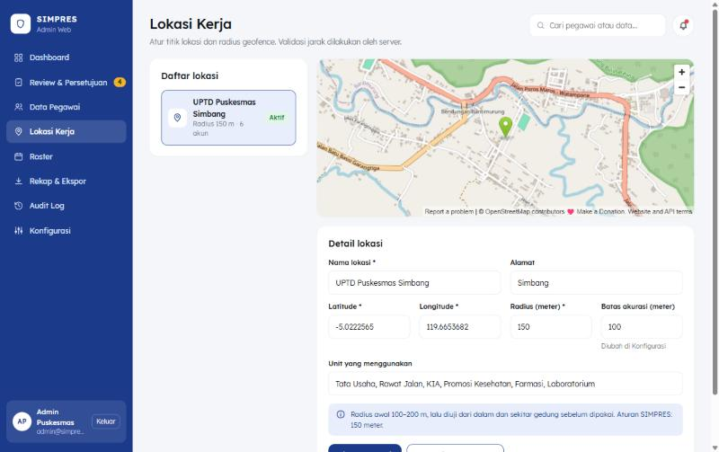 |

| **A5-3** Roster: non-shift dan shift bergantian | **A6-3** Review izin dengan lampiran, terima/tolak | **A6-5** Review tugas lapangan dengan foto dan koordinat |
|---|---|---|
| 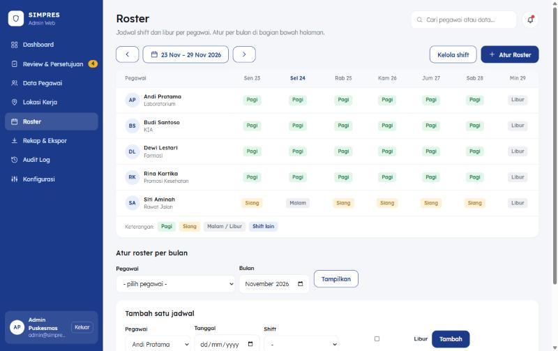 |  |  |

| **A7-1** Rekap per pegawai dan ekspor CSV | **A8-1** Audit log keputusan admin | **A9-1** Konfigurasi sistem |
|---|---|---|
| 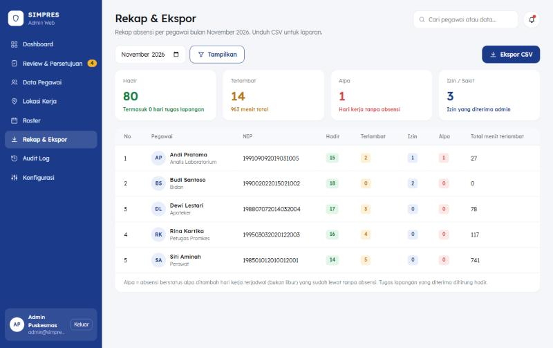 |  |  |

| ID | Yang diuji | Hasil |
|---|---|---|
| A1-1 | Buka /admin tanpa login diarahkan ke halaman login | ✅ Lulus |
| A1-2 | Sandi salah ditolak dengan pesan | ✅ Lulus |
| A1-3 | Akun pegawai tidak bisa masuk Admin Web | ✅ Lulus |
| A1-4 | Masuk ke Dashboard | ✅ Lulus |
| A2-2 | Dashboard menampilkan absensi hari ini | ✅ Lulus |
| A3-1 | Pegawai baru tersimpan dan tampil di daftar | ✅ Lulus |
| A3-1b | Akun baru bisa login lewat API | ✅ Lulus |
| A3-2 | Email ganda ditolak dengan pesan error | ✅ Lulus |
| A3-4 | Pencarian hanya menampilkan petugas lapangan | ✅ Lulus |
| A3-6 | Akun nonaktif tidak bisa login di aplikasi | ✅ Lulus |
| A4-1 | Titik Puskesmas dan radius 150 m tampil dengan peta | ✅ Lulus |
| A5-3 | Roster: non-shift Pagi, pegawai shift shift Siang/Malam bergantian | ✅ Lulus |
| A6-3 | Izin pegawai non-shift berstatus Diterima, catatan tersimpan | ✅ Lulus |
| A6-4 | Koreksi pegawai shift berstatus Ditolak dengan catatan | ✅ Lulus |
| A6-5 | Tugas lapangan petugas lapangan berstatus Diterima | ✅ Lulus |
| A6-6 | Pengajuan yang sudah diputuskan tidak punya tombol Terima/Tolak | ✅ Lulus |
| A7-1 | Rekap per pegawai tampil | ✅ Lulus |
| A7-3 | File CSV rekap terunduh dan berisi data pegawai | ✅ Lulus |
| A8-1 | Keputusan tadi tercatat di audit log | ✅ Lulus |
| A9-1 | Pengaturan sistem tampil per kelompok | ✅ Lulus |
| A1-5 | Setelah keluar, Dashboard tidak bisa dibuka lagi | ✅ Lulus |

## Pegawai non-shift (aplikasi Android)

Pegawai dengan jam kerja tetap (shift Pagi 07.30–14.00, Senin–Sabtu). Pengujian dimulai dari aplikasi yang baru dipasang.

**Fitur yang diuji:**

- Intro, onboarding, dan panduan awal
- Login (sandi salah ditolak, sandi benar masuk)
- Jadwal kerja non-shift
- Check-in GPS di Puskesmas dan status terlambat
- Check-in kedua di hari yang sama ditolak
- Riwayat absensi
- Izin keluar jam kerja (tanpa alasan ditolak, lalu terkirim)
- Check-out dengan slider
- Notifikasi keputusan admin
- Profil dan menu Koreksi Absensi
- Keluar dari akun

<a href="videos/1_pegawai_nonshift.mp4">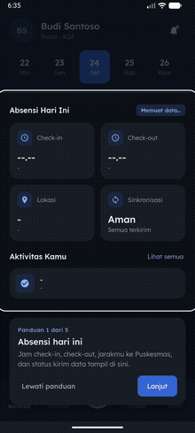</a>

Video lengkap: [videos/1_pegawai_nonshift.mp4](videos/1_pegawai_nonshift.mp4) · Hasil: **17/17 lulus**

| **B-1** Intro dan onboarding tampil | **B-4** Login sandi salah ditolak | **B-7** Panduan awal muncul pertama kali | **C1-0** Beranda: shift Pagi, belum check-in |
|---|---|---|---|
| 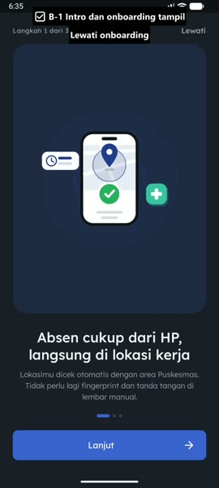 | 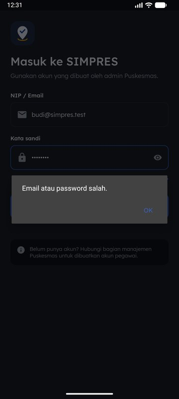 |  |  |

| **C1-1** Jadwal non-shift: Pagi setiap hari kerja, Minggu libur | **C2-3** Check-in diterima, status terlambat (aturan R5) | **C2-5a** Beranda: jam check-in terisi, slider check-out muncul | **C2-4** Check-in kedua ditolak (aturan R4) |
|---|---|---|---|
|  |  | 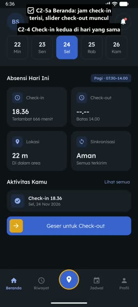 |  |

| **C4-1** Riwayat menampilkan absensi hari ini | **C3-0** Daftar izin tampil (izin sakit diterima) | **C3-4b** Tanpa alasan tidak terkirim, tetap di formulir | **C3-4** Izin keluar terkirim, status Menunggu Konfirmasi |
|---|---|---|---|
| 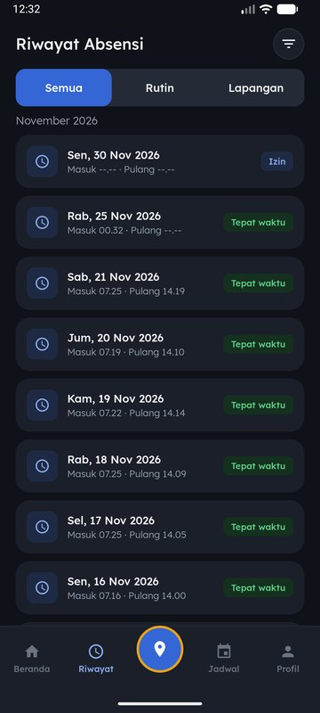 |  |  |  |

| **C2-5** Check-out diterima | **B-13** Notifikasi keputusan admin tampil | **B-15** Profil sesuai data admin (nama, NIP, unit) | **B-15b** Menu Koreksi Absensi ada di Profil |
|---|---|---|---|
| 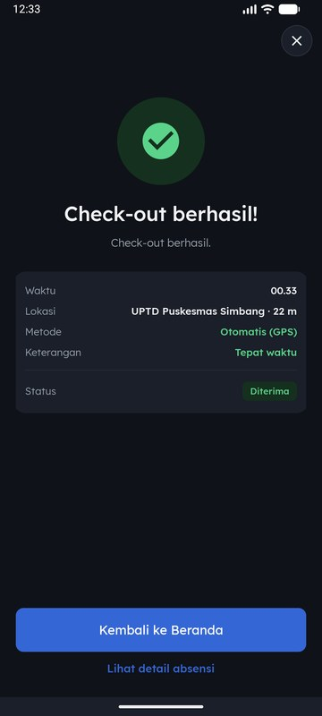 |  |  |  |

| **B-19** Kembali ke halaman login |
|---|
|  |

## Pegawai shift (aplikasi Android)

Pegawai dengan jam kerja bergantian (Pagi, Siang, Malam). Hari pengujian: shift Malam 21.00–07.00.

**Fitur yang diuji:**

- Beranda menampilkan shift Malam
- Jadwal shift Pagi/Siang bergantian
- Check-in dari luar radius ditolak (235 m)
- Peta asli: zoom dan geser
- Check-in tepat waktu sebelum shift Malam
- Koreksi absensi dari menu Profil
- Pengajuan cuti
- Check-out saat offline, lalu terkirim otomatis
- Keluar dari akun

Video lengkap: [videos/2_pegawai_shift.mp4](videos/2_pegawai_shift.mp4) · Hasil: **12/12 lulus**

| **D2-1** Beranda: shift hari ini Malam 21.00-07.00, belum check-in | **D1-1** Jadwal shift: Pagi dan Siang bergantian, Minggu libur | **D2-4** Ditolak: di luar radius 150 m, jarak tampil di peta (aturan R1) | **P8** Peta asli bisa di-zoom dan digeser |
|---|---|---|---|
|  | 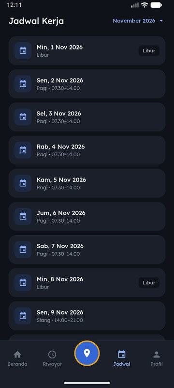 | 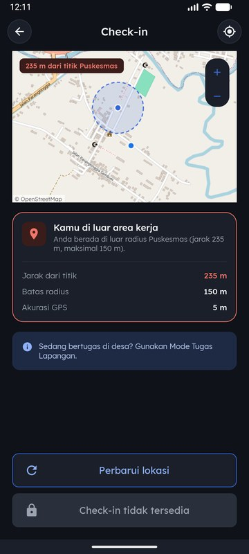 | 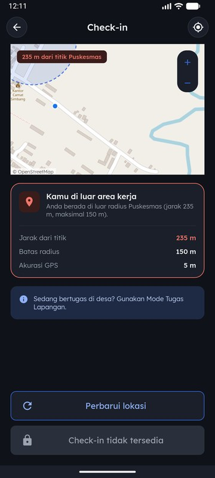 |

| **D2-2** Check-in diterima, tepat waktu sebelum shift Malam 21.00 | **D3-0** Halaman Koreksi Absensi bisa dibuka | **D3-1** Koreksi terkirim, kembali ke Beranda | **D4-1** Cuti terkirim, status Menunggu Konfirmasi |
|---|---|---|---|
| 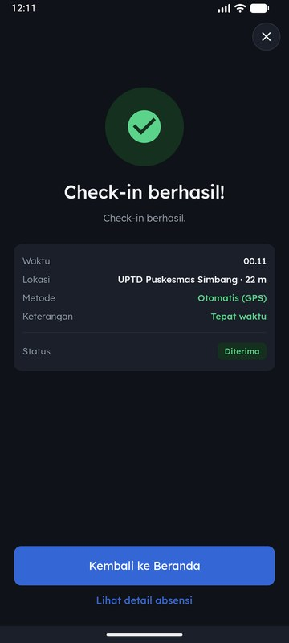 | 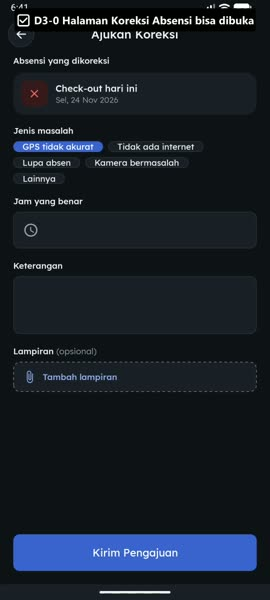 | 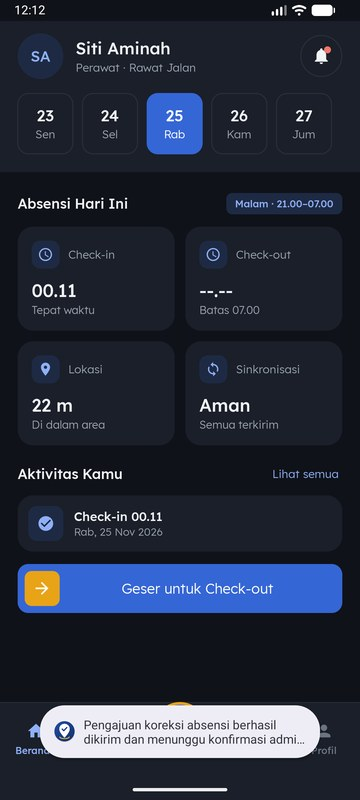 |  |

| **D4-1b** Cuti muncul di daftar izin | **F-1** Check-out disimpan di perangkat (offline) | **F-3** Antrean terkirim otomatis, check-out tercatat | **B-19** Kembali ke halaman login |
|---|---|---|---|
| 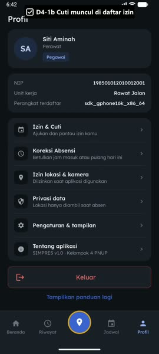 |  |  | 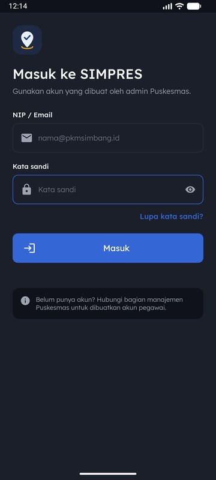 |

## Petugas lapangan (aplikasi Android)

Pegawai yang sering bertugas di luar gedung (posyandu, kunjungan rumah). Bukti kerja di luar memakai Tugas Lapangan.

**Fitur yang diuji:**

- Check-in dari posyandu (sekitar 1 km) ditolak dan ditawari Mode Tugas Lapangan
- Formulir tugas lapangan dengan GPS asli
- Kirim tanpa nama lokasi ditolak
- Izin kamera dan foto bukti kegiatan
- Tugas lapangan terkirim dan tampil di Riwayat > Lapangan
- Check-in setelah kembali ke Puskesmas
- Keluar dari akun

Video lengkap: [videos/3_petugas_lapangan.mp4](videos/3_petugas_lapangan.mp4) · Hasil: **10/10 lulus**

| **E1-1** Login berhasil, profil dan shift Pagi sesuai data admin | **E3-1** Check-in ditolak di luar radius, ditawari Mode Tugas Lapangan | **E2-0** Formulir tugas lapangan memakai GPS asli (bukan lokasi contoh) | **E2-3** Tanpa nama lokasi tidak terkirim, tetap di formulir |
|---|---|---|---|
|  | 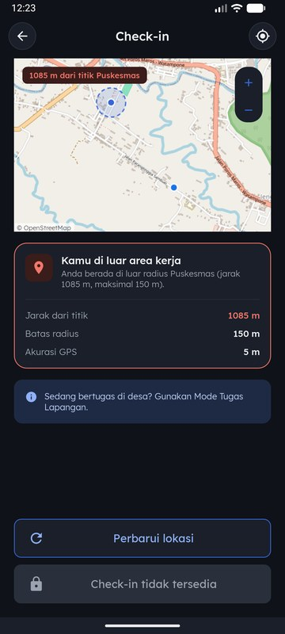 | 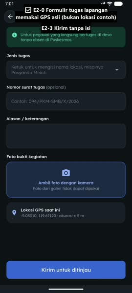 | 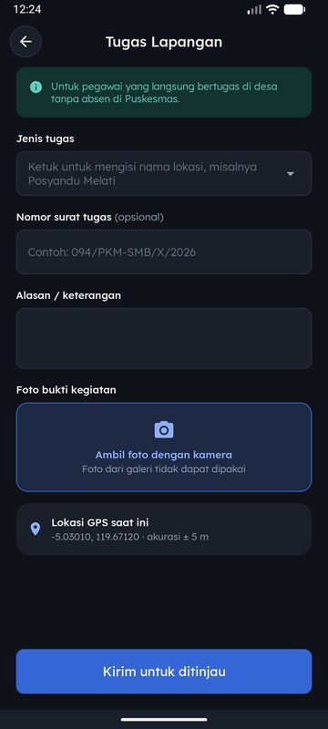 |

| **E2-2** Izin kamera diminta dulu (dulu aplikasi crash di sini) | **E2-2b** Foto kegiatan dari kamera terpasang | **E2-1** Tugas lapangan terkirim, kembali ke Beranda | **E2-1b** Tugas lapangan baru tampil dengan status Menunggu Konfirmasi |
|---|---|---|---|
| 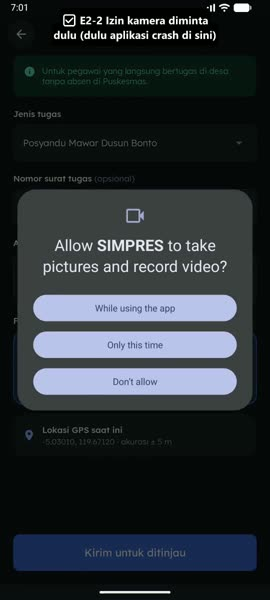 |  | 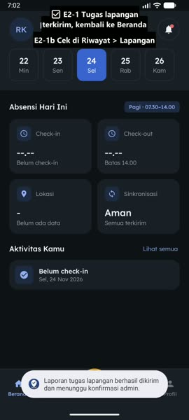 | 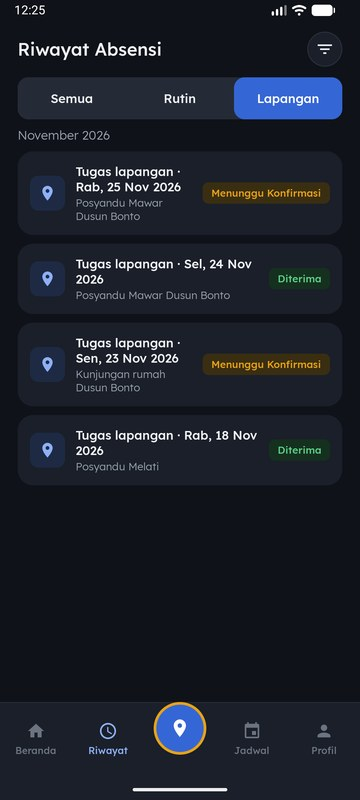 |

| **E1-2** Check-in di Puskesmas diterima | **B-19** Kembali ke halaman login |
|---|---|
| 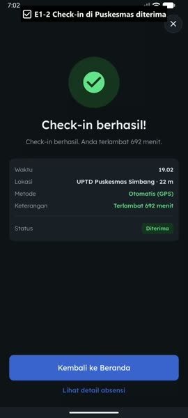 |  |

## Notifikasi seketika (Firebase Cloud Messaging)

Begitu admin memutuskan, server mengirim notifikasi lewat Firebase ke HP pegawai. Notifikasi muncul **1,3 detik** setelah
admin menekan Terima, walaupun aplikasi sedang ditutup.

**Fitur yang diuji:**

- Notifikasi keputusan admin (koreksi absensi diterima beserta catatan) muncul seketika di HP saat aplikasi ditutup
- Notifikasi diketuk membuka halaman Notifikasi

<a href="videos/7_notifikasi_firebase.mp4">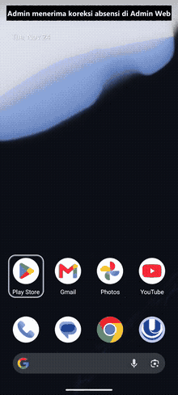</a>

Video lengkap: [videos/7_notifikasi_firebase.mp4](videos/7_notifikasi_firebase.mp4) · Hasil: **2/2 lulus**

| **N-4** Notifikasi muncul 1 detik setelah admin memutuskan | **N-5** Halaman Notifikasi terbuka |
|---|---|
|  |  |

## Notifikasi cadangan dan sinkronisasi otomatis

Cadangan jika Firebase tidak tersedia: aplikasi mengecek keputusan admin di latar belakang (WorkManager), sehingga
notifikasi tetap muncul walaupun aplikasi ditutup. Absensi yang tersimpan saat offline
terkirim otomatis di latar belakang begitu internet kembali, tanpa perlu membuka aplikasi (WorkManager).

**Fitur yang diuji:**

- Notifikasi keputusan admin (izin ditolak beserta catatan) muncul di HP saat aplikasi ditutup
- Notifikasi diketuk langsung membuka halaman Notifikasi
- Check-out saat mode pesawat disimpan di antrean HP
- Antrean terkirim di latar belakang setelah internet kembali, tanpa membuka aplikasi
- Beranda menampilkan check-out yang sudah terkirim

<a href="videos/6_notifikasi_dan_sinkronisasi.mp4">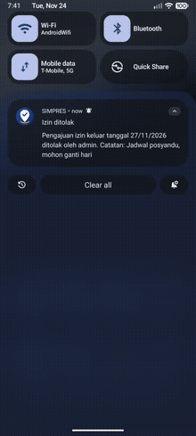</a>

Video lengkap: [videos/6_notifikasi_dan_sinkronisasi.mp4](videos/6_notifikasi_dan_sinkronisasi.mp4) · Hasil: **5/5 lulus**

| **N-1** Notifikasi 'Izin ditolak' beserta catatan admin muncul di HP | **N-2** Notifikasi diketuk langsung membuka halaman Notifikasi | **F-1** Check-out disimpan di antrean HP | **F-4** Check-out terkirim ke server di latar belakang, tanpa membuka aplikasi |
|---|---|---|---|
|  |  |  | 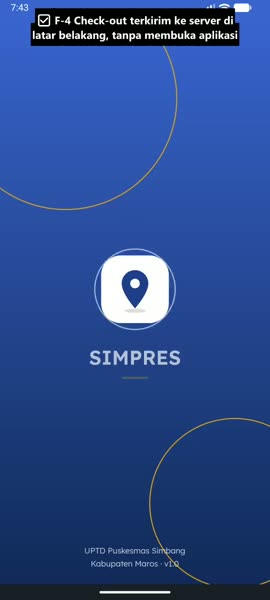 |

| **F-3** Beranda: jam check-out terisi, status Semua terkirim |
|---|
| 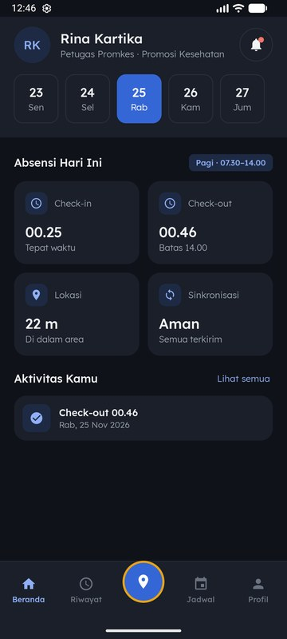 |

| F-4 Antrean terkirim di latar belakang | ✅ Dicek langsung ke server: `has_checked_out = true` sebelum aplikasi dibuka |
|---|---|

## Integrasi aplikasi dan Admin Web

Keputusan admin di video Admin Web dicek dari HP masing-masing pegawai.

<a href="videos/5_integrasi_aplikasi_web.mp4">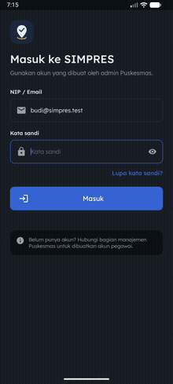</a>

Video lengkap: [videos/5_integrasi_aplikasi_web.mp4](videos/5_integrasi_aplikasi_web.mp4) · Hasil: **5/5 lulus**

| **G-7** Pegawai non-shift menerima notifikasi izin keluar diterima beserta catatan admin | **G-7b** Status izin keluar pegawai non-shift berubah menjadi Diterima | **D3-4** Pegawai shift menerima notifikasi koreksi ditolak dengan catatan admin | **D4-2** Pegawai shift menerima notifikasi cuti diterima |
|---|---|---|---|
|  |  | 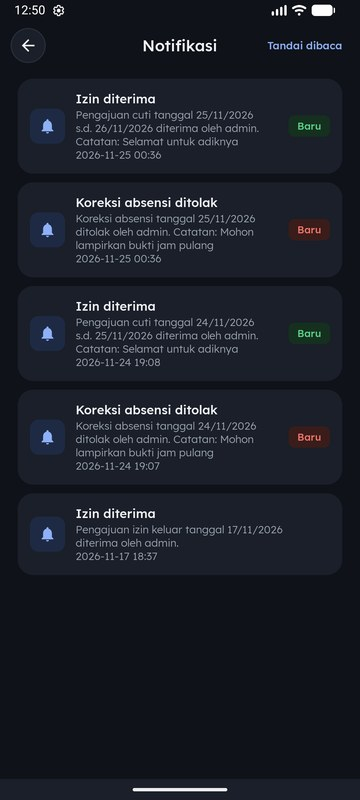 | 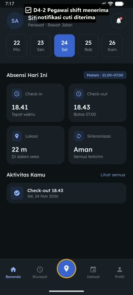 |

| **E2-4** Tugas lapangan petugas berstatus Diterima |
|---|
| 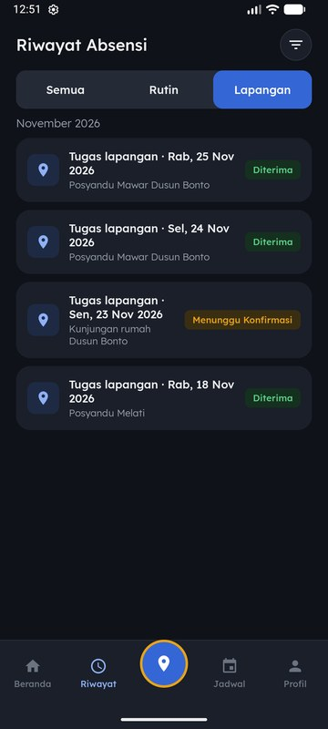 |

## Data uji

Data uji dibuat lewat API dan Admin Web yang sama dengan pemakaian nyata: pegawai non-shift, pegawai shift,
petugas lapangan, shift Pagi/Siang/Malam, roster November 2026, riwayat absensi, serta pengajuan izin, koreksi, dan
tugas lapangan. Ganti semua sandi `simpres123` sebelum aplikasi dipakai sungguhan.
