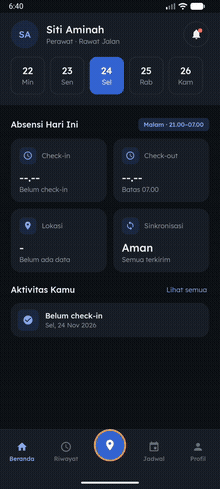
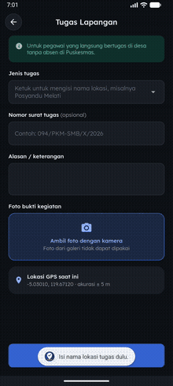
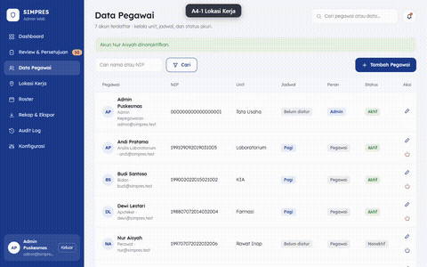

# Hasil Pengujian per Pengguna

Pengujian 24 November 2026 dengan data dan server asli (Laravel + MySQL), aplikasi Android versi rilis di emulator,
dan Admin Web di Chrome. Setiap pengujian direkam video. Setiap langkah dicek otomatis dari teks yang tampil di layar,
lalu dicatat ✅ (lulus) atau ❌ (gagal). ID langkah mengikuti [SKEMA_PENGUJIAN.md](SKEMA_PENGUJIAN.md).

Video bisa diputar langsung di GitHub dengan membuka file `.mp4`. GIF di bawah adalah cuplikan singkatnya.

## Ringkasan

| Pengguna | Video | Lulus |
|---|---|---|
| Pegawai non-shift: Budi Santoso | [1_pegawai_nonshift_budi.mp4](videos/1_pegawai_nonshift_budi.mp4) | 17/17 |
| Pegawai shift: Siti Aminah | [2_pegawai_shift_siti.mp4](videos/2_pegawai_shift_siti.mp4) | 12/12 |
| Petugas lapangan: Rina Kartika | [3_petugas_lapangan_rina.mp4](videos/3_petugas_lapangan_rina.mp4) | 10/10 |
| Admin: Admin Puskesmas (Admin Web) | [4_admin_web.mp4](videos/4_admin_web.mp4) | 21/21 |
| Integrasi aplikasi dan Admin Web | [5_integrasi_aplikasi_web.mp4](videos/5_integrasi_aplikasi_web.mp4) | 5/5 |
| **Total** | | **65/65** |

Selain itu, `php artisan test` di folder `backend`: **138 test lulus**.

Bug yang ditemukan selama pengujian ini (menu Koreksi Absensi tidak bisa dibuka, aplikasi crash saat ambil foto, peta kosong
di jaringan lambat) sudah diperbaiki sebelum video final direkam. Rinciannya ada di [BUG_DAN_PERBAIKAN.md](BUG_DAN_PERBAIKAN.md).

## Pegawai non-shift: Budi Santoso

Bidan, unit KIA, shift Pagi 07.30–14.00 setiap Senin–Sabtu, Minggu libur. Login `budi@simpres.test`.

Video lengkap: [videos/1_pegawai_nonshift_budi.mp4](videos/1_pegawai_nonshift_budi.mp4) · Hasil: **17/17 lulus**

| ID | Yang diuji | Hasil |
|---|---|---|
| B-1 | Intro dan onboarding tampil | ✅ Lulus |
| B-4 | Login sandi salah ditolak | ✅ Lulus |
| B-7 | Panduan awal muncul pertama kali | ✅ Lulus |
| C1-0 | Beranda: shift Pagi, belum check-in | ✅ Lulus |
| C1-1 | Jadwal non-shift: Pagi setiap hari kerja, Minggu libur | ✅ Lulus |
| C2-3 | Check-in diterima, status terlambat (aturan R5) | ✅ Lulus |
| C2-5a | Beranda: jam check-in terisi, slider check-out muncul | ✅ Lulus |
| C2-4 | Check-in kedua ditolak (aturan R4) | ✅ Lulus |
| C4-1 | Riwayat menampilkan absensi hari ini | ✅ Lulus |
| C3-0 | Daftar izin tampil (izin sakit diterima) | ✅ Lulus |
| C3-4b | Tanpa alasan tidak terkirim, tetap di formulir | ✅ Lulus |
| C3-4 | Izin keluar terkirim, status Menunggu Konfirmasi | ✅ Lulus |
| C2-5 | Check-out diterima | ✅ Lulus |
| B-13 | Notifikasi keputusan admin tampil | ✅ Lulus |
| B-15 | Profil sesuai data admin (nama, NIP, unit) | ✅ Lulus |
| B-15b | Menu Koreksi Absensi ada di Profil | ✅ Lulus |
| B-19 | Kembali ke halaman login | ✅ Lulus |

## Pegawai shift: Siti Aminah

Perawat Rawat Jalan, shift bergantian Pagi/Siang/Malam. Hari pengujian: shift Malam 21.00–07.00. Login `siti@simpres.test`.

Video lengkap: [videos/2_pegawai_shift_siti.mp4](videos/2_pegawai_shift_siti.mp4) · Hasil: **12/12 lulus**

| ID | Yang diuji | Hasil |
|---|---|---|
| D2-1 | Beranda: shift hari ini Malam 21.00-07.00, belum check-in | ✅ Lulus |
| D1-1 | Jadwal shift: Pagi dan Siang bergantian, Minggu libur | ✅ Lulus |
| D2-4 | Ditolak: di luar radius 150 m, jarak tampil di peta (aturan R1) | ✅ Lulus |
| P8 | Peta asli bisa di-zoom dan digeser | ✅ Lulus |
| D2-2 | Check-in diterima, tepat waktu sebelum shift Malam 21.00 | ✅ Lulus |
| D3-0 | Halaman Koreksi Absensi bisa dibuka | ✅ Lulus |
| D3-1 | Koreksi terkirim, kembali ke Beranda | ✅ Lulus |
| D4-1 | Cuti terkirim, status Menunggu Konfirmasi | ✅ Lulus |
| D4-1b | Cuti muncul di daftar izin | ✅ Lulus |
| F-1 | Check-out disimpan di perangkat (offline) | ✅ Lulus |
| F-3 | Antrean terkirim otomatis, check-out tercatat | ✅ Lulus |
| B-19 | Kembali ke halaman login | ✅ Lulus |

## Petugas lapangan: Rina Kartika

Petugas Promkes, sering bertugas di posyandu (di luar radius Puskesmas). Login `rina@simpres.test`.

Video lengkap: [videos/3_petugas_lapangan_rina.mp4](videos/3_petugas_lapangan_rina.mp4) · Hasil: **10/10 lulus**

| ID | Yang diuji | Hasil |
|---|---|---|
| E1-1 | Login berhasil, profil dan shift Pagi sesuai data admin | ✅ Lulus |
| E3-1 | Check-in ditolak di luar radius, ditawari Mode Tugas Lapangan | ✅ Lulus |
| E2-0 | Formulir tugas lapangan memakai GPS asli (bukan lokasi contoh) | ✅ Lulus |
| E2-3 | Tanpa nama lokasi tidak terkirim, tetap di formulir | ✅ Lulus |
| E2-2 | Izin kamera diminta dulu (dulu aplikasi crash di sini) | ✅ Lulus |
| E2-2b | Foto kegiatan dari kamera terpasang | ✅ Lulus |
| E2-1 | Tugas lapangan terkirim, kembali ke Beranda | ✅ Lulus |
| E2-1b | Tugas lapangan baru tampil dengan status Menunggu Konfirmasi | ✅ Lulus |
| E1-2 | Check-in di Puskesmas diterima | ✅ Lulus |
| B-19 | Kembali ke halaman login | ✅ Lulus |

## Admin: Admin Puskesmas (Admin Web)

Mengelola pegawai, roster, dan memutuskan pengajuan dari aplikasi. Login `admin@simpres.test` di `/admin`.

Video lengkap: [videos/4_admin_web.mp4](videos/4_admin_web.mp4) · Hasil: **21/21 lulus**

| ID | Yang diuji | Hasil |
|---|---|---|
| A1-1 | Buka /admin tanpa login diarahkan ke halaman login | ✅ Lulus |
| A1-2 | Sandi salah ditolak dengan pesan | ✅ Lulus |
| A1-3 | Akun pegawai tidak bisa masuk Admin Web | ✅ Lulus |
| A1-4 | Masuk ke Dashboard | ✅ Lulus |
| A2-2 | Dashboard menampilkan absensi hari ini (Budi, Siti, Rina dari aplikasi) | ✅ Lulus |
| A3-1 | Pegawai baru tersimpan dan tampil di daftar | ✅ Lulus |
| A3-1b | Akun baru bisa login lewat API | ✅ Lulus |
| A3-2 | Email ganda ditolak dengan pesan error | ✅ Lulus |
| A3-4 | Pencarian hanya menampilkan Rina | ✅ Lulus |
| A3-6 | Akun nonaktif tidak bisa login di aplikasi | ✅ Lulus |
| A4-1 | Titik Puskesmas dan radius 150 m tampil dengan peta | ✅ Lulus |
| A5-3 | Roster: non-shift Pagi, Siti shift Siang/Malam bergantian | ✅ Lulus |
| A6-3 | Izin Budi berstatus Diterima, catatan tersimpan | ✅ Lulus |
| A6-4 | Koreksi Siti berstatus Ditolak dengan catatan | ✅ Lulus |
| A6-5 | Tugas lapangan Rina berstatus Diterima | ✅ Lulus |
| A6-6 | Pengajuan yang sudah diputuskan tidak punya tombol Terima/Tolak | ✅ Lulus |
| A7-1 | Rekap per pegawai tampil | ✅ Lulus |
| A7-3 | File CSV rekap terunduh dan berisi data pegawai | ✅ Lulus |
| A8-1 | Keputusan tadi tercatat di audit log | ✅ Lulus |
| A9-1 | Pengaturan sistem tampil per kelompok | ✅ Lulus |
| A1-5 | Setelah keluar, Dashboard tidak bisa dibuka lagi | ✅ Lulus |

## Integrasi aplikasi dan Admin Web

Keputusan admin di video 4 dicek dari HP Budi, Siti, dan Rina.

Video lengkap: [videos/5_integrasi_aplikasi_web.mp4](videos/5_integrasi_aplikasi_web.mp4) · Hasil: **5/5 lulus**

| ID | Yang diuji | Hasil |
|---|---|---|
| G-7 | Budi menerima notifikasi izin keluar diterima beserta catatan admin | ✅ Lulus |
| G-7b | Status izin keluar Budi berubah menjadi Diterima | ✅ Lulus |
| D3-4 | Siti menerima notifikasi koreksi ditolak dengan catatan admin | ✅ Lulus |
| D4-2 | Siti menerima notifikasi cuti diterima | ✅ Lulus |
| E2-4 | Tugas lapangan Rina berstatus Diterima | ✅ Lulus |

## Data uji

Data uji dibuat lewat API dan Admin Web yang sama dengan pemakaian nyata: 6 pegawai, shift Pagi/Siang/Malam, roster
November 2026, riwayat absensi 2–24 November, serta pengajuan izin, koreksi, dan tugas lapangan. Ganti semua sandi
`simpres123` sebelum aplikasi dipakai sungguhan.
